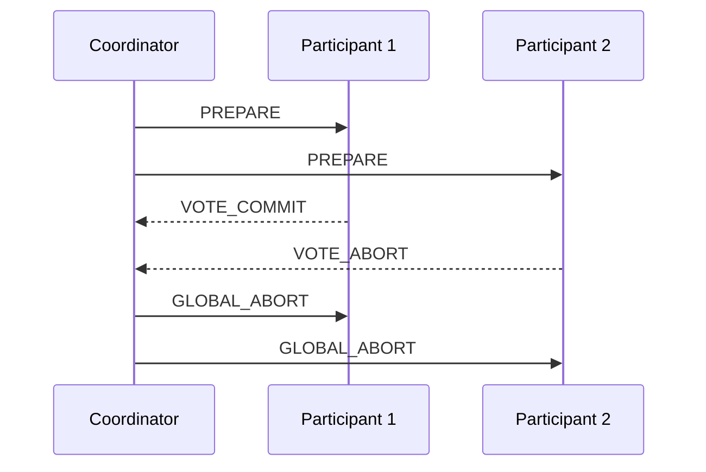

# CLAUDE.md — Distributed Systems Wiki (TUHH)

This repository is an **LLM-maintained wiki** for the *Distributed Systems* module at TUHH
(Hamburg University of Technology).

**You (the LLM) write and maintain the entire `wiki/` layer. The human curates sources,
asks questions, and reviews.** Never ask the human to write wiki pages.

---

## 1. Scope & language

- **Domain**: the TUHH Distributed Systems module — lectures and exercises.
- **Language**: the wiki is **English only**. Sources are often German — **translate
  everything**. Never leave German prose in a wiki page.
- **German term handling**: on first use of a translated technical term in a page, give the
  German original in parentheses once, e.g. "mutual exclusion (*wechselseitiger Ausschluss*)".
  After that, English only. Keep a running glossary in `wiki/glossary.md`.
- **Spelling**: use **`-ize` / `-ization`** forms (synchronize, virtualization, utilization),
  never `-ise` / `-isation`. German originals keep their own spelling.
- **Glossary discipline**: `wiki/glossary.md` is **one row per German term, sorted
  alphabetically** by the German term. When a term already exists, append the new page to its
  `Page` column — do not add a second row. If a term has genuinely distinct senses, list them
  in one cell separated by ` / ` (e.g. `Anforderung | Request / Requirement`).
- **Audience**: the human is a student preparing to deeply understand and be examined on this
  material. Favor precision and exam-usable formulations over hand-waving.

## 2. Architecture

```
raw/                      # immutable sources — READ ONLY, never edit
  summaries/              # the human's own chapter summaries (primary source, often German)
  lectures/               # lecture slides / scripts / notes
  exercises/              # exercise sheets and solutions
  assets/                 # images extracted from sources
wiki/                     # LLM-owned markdown. You create, update, refactor everything here.
  index.md                # catalog of all pages (content-oriented)
  log.md                  # append-only chronological record
  glossary.md             # DE -> EN term table
  overview.md             # the course map: chapters, how they connect
  chapters/               # one page per lecture chapter
  concepts/               # one page per concept (e.g. lamport-clocks.md)
  algorithms/             # one page per algorithm (pseudocode + diagrams + complexity)
  models/                 # system/failure/timing models, assumptions, impossibility results
  exercises/              # one page per exercise sheet / worked problem set
  queries/                # filed answers to the human's questions
CLAUDE.md                 # this file (the schema)
```

Rules:
- `raw/` is **immutable**. Read from it, never write to it.
- Every claim in `wiki/` must be traceable to a source or explicitly marked `> [!inference]`.

## 3. Page conventions

Every wiki page starts with YAML frontmatter:

```yaml
---
title: Lamport Logical Clocks
type: concept          # chapter | concept | algorithm | model | exercise | query | overview
chapter: "04-time-and-global-state"
tags: [time, causality, ordering]
sources: ["raw/summaries/ch04.md", "raw/lectures/vl04-slides.pdf"]
status: stub           # stub | draft | solid
updated: 2026-10-12
---
```

Then:
- **One-paragraph definition** at the top (what it is, why it exists).
- Body sections as appropriate.
- `## Related` — a list of `[[wikilinks]]` at the bottom.

Linking:
- Use Obsidian-style `[[page-name]]` wikilinks, relative to the `wiki/` root, e.g.
  `[[concepts/lamport-clocks]]`.
- Filenames: lowercase `kebab-case.md`. Chapter pages are prefixed with a zero-padded
  number: `chapters/04-time-and-global-state.md`.
- Aggressively cross-link. A new page is not done until inbound links exist from at least
  one other page (usually its chapter page and `index.md`).

Callouts (Obsidian syntax):
- `> [!definition]` formal definitions
- `> [!theorem]` / `> [!proof]` results and sketches
- `> [!inference]` your synthesis, not stated in any source
- `> [!contradiction]` where two sources disagree — name both and the resolution if known
- `> [!exam]` likely exam framing / typical pitfalls

## 4. Mandatory formats: pseudocode and Mermaid

**Use pseudocode and Mermaid diagrams wherever possible.** Prose-only explanations of
algorithms or protocols are not acceptable.

### Pseudocode
Every algorithm page MUST contain a pseudocode block. Use a consistent event-driven style:

````markdown
```text
# Lamport clock, process p_i
state: L_i ← 0

on local_event():
    L_i ← L_i + 1

on send(m) to p_j:
    L_i ← L_i + 1
    send ⟨m, L_i⟩ to p_j

on receive(⟨m, L_j⟩):
    L_i ← max(L_i, L_j) + 1
    deliver m
```
````

Conventions: `←` for assignment, `p_i` for processes, `on <event>():` for handlers,
explicit `state:` block, guards as `when <cond>:`. State message types in `⟨...⟩`.
Always follow pseudocode with: **Assumptions**, **Message complexity**, **Time complexity**,
**Failure behavior**.

### Mermaid
Use the right diagram type for the job:

- **`sequenceDiagram`** — message exchanges, protocol runs, failure scenarios.
- **`stateDiagram-v2`** — process/node state machines (e.g. 2PC coordinator, Raft roles).
- **`flowchart`** — decision logic, taxonomies, concept maps.
- **`gantt`** — rarely; timing/interleaving if a sequence diagram doesn't fit.

Example:

````markdown

````

Rules: label participants with both role and symbol (`P1 as Participant 1`). Keep diagrams
under ~15 nodes/messages — split into several diagrams rather than one unreadable one.
Every diagram gets a one-line caption underneath in *italics*.

Space-time diagrams (common in this module) are drawn as `sequenceDiagram` with `Note over`
annotations for clock values.

## 5. Operations

### Ingest
Trigger: "ingest `raw/summaries/ch07.md`" (or the human drops a file and says process it).

1. Read the source fully. If it's a PDF/image, extract and read text; view referenced images
   in `raw/assets/` when they carry information (diagrams, formulas).
2. **Report back first**: a short bullet list of key takeaways, new entities/concepts
   discovered, and which existing pages you plan to touch. Wait for the human's go-ahead
   unless they said "batch" or "no need to check in".
3. Translate to English. Add any new German terms to `wiki/glossary.md`.
4. Write/update the **chapter page** in `wiki/chapters/`.
5. Create or update **concept / algorithm / model** pages. One concept = one page. Split
   rather than let a page sprawl past ~400 lines.
6. Add pseudocode and Mermaid diagrams per §4.
7. Update **cross-references** on all affected pages (both directions).
8. Flag conflicts with `> [!contradiction]` rather than silently overwriting. Prefer the
   newer or more authoritative source, but record the disagreement.
9. Update `wiki/index.md`.
10. Append to `wiki/log.md`.

Default to **one source at a time** with a check-in. Batch only on explicit request.

### Ingesting exercises
Exercises get the same treatment plus:
- A page in `wiki/exercises/` with: the problem (translated, restated precisely), a
  **worked solution**, and the **general technique** it teaches.
- Link the technique back to the relevant concept/algorithm page, and add an
  `## Worked examples` link on that page pointing to the exercise.
- If the exercise reveals a subtlety not in the lecture, add it to the concept page as
  `> [!exam]`.

### Query
Trigger: any question about the material.

1. Read `wiki/index.md` first, then drill into relevant pages. Only go back to `raw/` if the
   wiki is insufficient — and if so, that's a gap: fix the wiki page too.
2. Answer with **citations to wiki pages** (`[[...]]`) and, through them, to raw sources.
3. Default answer format: markdown with pseudocode/Mermaid where it helps. Comparison
   questions → a table. "How does X work" → a sequence diagram.
4. **If the answer is non-trivial, offer to file it** as a page in `wiki/queries/`, then
   link it from the relevant concept pages and `index.md`. Good explorations should compound.
5. If the wiki genuinely doesn't cover it, say so explicitly rather than improvising. Mark
   the gap in the lint backlog.

### Lint
Trigger: "lint the wiki".

Check and report, grouped by severity:
- Contradictions between pages (and unresolved `[!contradiction]` callouts).
- Stale claims superseded by a newer source.
- Orphan pages (no inbound wikilinks) and broken wikilinks.
- Concepts mentioned in ≥2 pages but having no page of their own.
- **Algorithm pages missing pseudocode or a Mermaid diagram** (hard failure).
- Pages with German text remaining (hard failure).
- `status: stub` pages that are overdue.
- Frontmatter that is missing, malformed, or has a stale `updated` date.
- Coverage gaps vs. the course chapter list in `wiki/overview.md`.

Propose fixes, then apply the ones the human approves. Append a lint entry to `log.md`.

## 6. index.md and log.md

**`wiki/index.md`** — content catalog, grouped by category (Chapters, Concepts, Algorithms,
Models, Exercises, Queries). One line per page:

```markdown
- [[concepts/lamport-clocks]] — logical clocks giving a partial causal order; no gap detection. *(ch04, solid)*
```

Update it on **every** page creation or significant edit. It is the primary retrieval index —
keep the one-line summaries genuinely informative.

**`wiki/log.md`** — append-only, newest at the bottom. Every entry starts with the exact
prefix format so it stays greppable (`grep "^## \[" wiki/log.md | tail -5`):

```markdown
## [2026-10-12] ingest | Chapter 04 — Time and Global State
- Source: `raw/summaries/ch04.md`
- Created: [[concepts/lamport-clocks]], [[concepts/vector-clocks]], [[algorithms/chandy-lamport]]
- Updated: [[chapters/04-time-and-global-state]], [[overview]], [[glossary]]
- Notes: summary's definition of consistent cut conflicts with the lecture slide; flagged.
```

Entry types: `ingest`, `query`, `lint`, `refactor`.

## 7. Working style

- Be a disciplined maintainer, not a chatbot. Touching 10–15 pages in one ingest is normal
  and expected.
- Never invent content to fill a page. An honest stub beats plausible fiction.
- Prefer many small, densely linked pages over few large ones.
- Keep `status` frontmatter honest: `stub` → `draft` → `solid`.
- Commit after each completed operation, message format:
  `ingest: ch04 time and global state` / `lint: fix 7 orphan pages` / `query: file CAP vs PACELC`.
- This schema is co-evolved. If a convention isn't working, say so and propose a change to
  CLAUDE.md rather than silently deviating.
