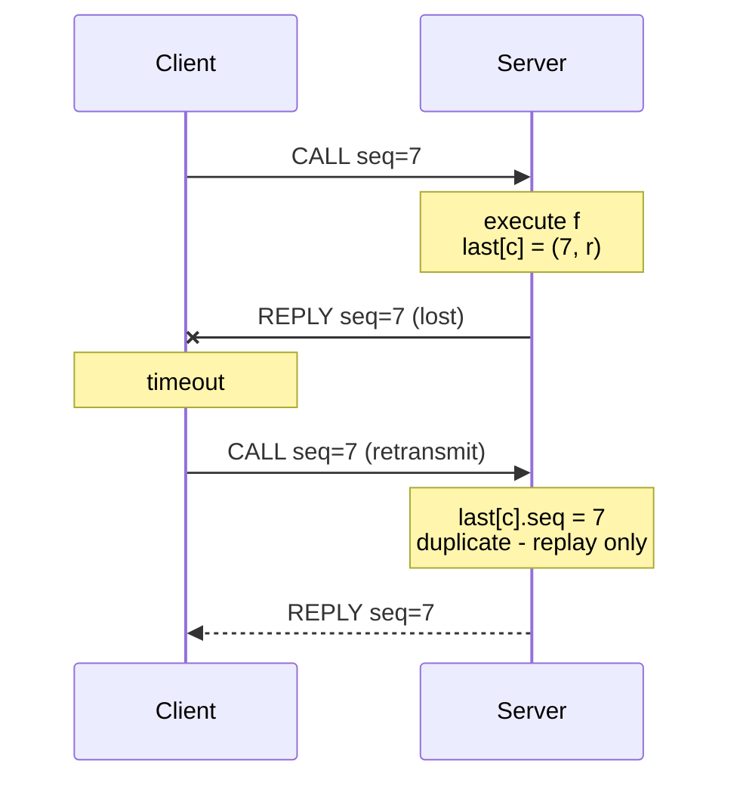

# At-Most-Once RPC (Duplicate Suppression)

The protocol that upgrades a retransmitting RPC from
[[concepts/call-semantics|at-least-once to at-most-once]]: the server remembers the last
call of each client and replays the stored answer instead of re-executing.

## Idea

> From the summary (exercise 4.3): **store for each client the last call; compare each new
> call with the last call of that client; if it is the same, then do not execute the call.**

## Pseudocode

### Client

```text
state:
    seq ← 0                                   # monotonically increasing call counter

on call(f, args):
    seq ← seq + 1
    m ← ⟨CALL, client_id, seq, f, args⟩
    attempts ← 0
    repeat:
        send m to the server
        wait for ⟨REPLY, seq, result⟩, at most TIMEOUT
        attempts ← attempts + 1
    until a reply with a matching seq arrives or attempts = MAX_ATTEMPTS
    if no reply:
        raise RemoteException                 # the call MAY or MAY NOT have run
    return result
```

### Server

```text
state:
    last[c] ← ⊥   for every client c          # ⟨seq, result⟩ of the most recent call

on receive ⟨CALL, c, s, f, args⟩ from client c:
    if last[c] ≠ ⊥ and last[c].seq = s:
        send ⟨REPLY, s, last[c].result⟩ to c  # duplicate: replay, do NOT execute
    else:
        result ← execute f(args)              # at most once, by construction
        last[c] ← ⟨s, result⟩                 # only the LAST answer is kept
        send ⟨REPLY, s, result⟩ to c
```

## Message flow



## Analysis

**Assumptions:**
- The client is **synchronous**: it never issues call *s*+1 before the answer to call *s*
  arrives. This is what allows the history to hold **only the last answer per client** — it
  is why the summary can say *"per client only the last answer must be stored"*.
- Sequence numbers are per client and monotonically increasing.
- The server's `last[]` table lives **in volatile memory**.

**Message complexity:** 2 messages in the failure-free case; 2·(1 + *r*) with *r*
retransmissions.

**Time complexity:** one round trip when nothing is lost; up to `MAX_ATTEMPTS · TIMEOUT`
otherwise.

**Space complexity:** O(number of clients) — one entry each, independent of the call count.

**Failure behaviour:**
- Lost **call** message ⇒ retransmission reaches a server with no matching entry ⇒ executed
  once. ✔
- Lost **reply** message ⇒ retransmission matches ⇒ **replayed, not re-executed**. ✔
- **Server crash** ⇒ `last[]` is gone. A retransmission after restart is no longer
  recognized as a duplicate, so the call may run a second time — or, if the crash came
  before execution, zero times.

> [!warning]
> The crash case is why this gives **at-most-once and not exactly-once**. Surviving it would
> require `last[]` to be [[concepts/persistent-data-storage|persistent]] *and* updated
> atomically with the side effect — which is the
> [[algorithms/two-phase-commit|atomic-commit]] problem all over again.

> [!exam]
> Give the guarantee precisely: **zero or one executions**, never two. The client that gets
> no reply **cannot tell which** — it must be written to tolerate both.

## Related
- [[concepts/call-semantics]]
- [[concepts/remote-call-failures]]
- [[algorithms/two-phase-commit]]
- [[concepts/remote-invocation]]
- [[exercises/ex04-rpc-rmi-and-ber]]
- [[chapters/04-remote-invocation]]
