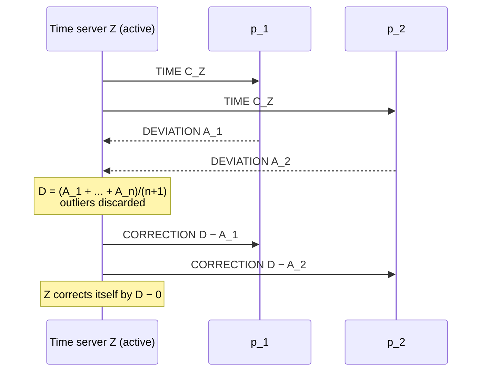

# Berkeley Algorithm

**Internal synchronization** by averaging. **The time server `Z` is active** — it polls
rather than being polled.

## The procedure

- **`Z` sends every computer its time at regular intervals**
- **every computer `R_i` answers with its deviation `A_i` from the time of `Z`**
- **`Z` computes the average**

  ```text
  D = (A_1 + … + A_n) / (n + 1)
  ```

- **`Z` sends every computer `R_i` the correction time**

  ```text
  D_i = D − A_i
  ```

- **all computers correct their clock time — `Z` itself included**
- **instead of the average, `Z` may also send other values**
- **improvement: when computing `D`, `Z` discards outliers** (*Ausreißer*)

> [!inference]
> `D_i = D − A_i` is the reason the algorithm is correct by construction. Since every `A_i`
> is measured against `Z`'s clock, adding `D_i` to `R_i` moves it to `Z + D` — **the same
> target for every `i`** — so after the round all clocks read the same value regardless of
> where they started. The averaging is not what achieves agreement; it only chooses *which*
> common value. That is exactly why the summary can say `Z` may send "other values"
> instead and why the exercise can criticize the mean without breaking the algorithm.

> [!inference]
> The `n + 1` in the denominator is not a typo: the master's own deviation `A_0 = 0` is one
> of the terms being averaged, so the sum of `n` slave deviations is divided by the total
> group size. Exercise 5.3 confirms this — five computers, `Σ A_j = −5`, `D = −1`.

## Pseudocode

```text
state (at the master Z):
    A[i] ← ⊥   for every computer p_i in the group

on synchronization_round():                      # executed by the master Z
    for each p_i in group:
        send ⟨TIME, C_Z⟩ to p_i
    collect ⟨DEVIATION, A_i⟩ from every p_i
    A[0] ← 0                                     # the master's deviation from itself
    A' ← {A[i] : p_i not an outlier}             # the suggested improvement
    D ← sum(A') / |A'|
    for each p_i in group ∪ {Z}:                 # every clock is corrected,
        send ⟨CORRECTION, D − A[i]⟩ to p_i       # including the discarded outliers

on receive ⟨TIME, C_Z⟩ at p_i:                   # executed by each slave
    A_i' ← local_clock() − C_Z                   # measured on arrival
    A_i  ← A_i' − RTT/2                          # discount the one-way transit
    send ⟨DEVIATION, A_i⟩ to Z

on receive ⟨CORRECTION, D_i⟩ at p_i:
    adjust local clock by D_i                    # slew, never jump
```

## Message flow



## Analysis

**Assumptions:**
- the round-trip time to each computer is known and **symmetric**, so that `RTT/2` is the
  correct discount for one-way transit (this is inherited from
  [[algorithms/cristians-algorithm|Cristian]]).
- the group membership is known to `Z`.
- the clocks are **not** assumed to be correct with respect to real time — this is internal
  synchronization only.

**Message complexity:** `3n` per round — one `TIME`, one `DEVIATION` and one `CORRECTION`
per computer.

**Time complexity:** two round trips (poll, then correct).

**Failure behaviour:**
- If a slave does not answer, it is simply absent from the average; it stays unsynchronized.
- **If `Z` fails, synchronization stops.** But: **with the Berkeley algorithm, in principle
  every computer can take over the role of the time server, i.e. this function can be
  passed on.**

> [!warning]
> **Criticism (from the summary): Berkeley and Cristian need central components and have
> all the associated disadvantages — a bottleneck and poor failure-tolerance behaviour.**
> Berkeley softens this because the master role is transferable; Cristian cannot, because
> its master is the one holding UTC.

> [!warning]
> **The average can make things worse.** Exercise 5.1 c) asks exactly this: *"some time
> algorithms form the arithmetic mean of the clock times and take this value as the new
> time"* — the answer being that **the value can be changed for the worse**. Exercise 5.3
> (2) then constructs the case: the one computer that held the **correct** time is moved 3
> seconds away from it. See
> [[exercises/ex05-storage-and-clock-synchronization]].

> [!inference]
> Discarding outliers is a partial defence but it attacks the wrong failure. It protects
> against a *badly broken* clock, not against a *systematically skewed group* — if four
> clocks are wrong in the same direction, the one correct clock is the outlier. Berkeley is
> internal synchronization; by [[concepts/clock-synchronization]] it simply makes no claim
> about real time, and no amount of filtering can create one.

> [!exam]
> Contrast with Cristian in one line each: **Cristian = external, client-initiated,
> `C_UTC + δ/2`, fails on asymmetric latency. Berkeley = internal, server-initiated,
> `D_i = D − A_i`, fails because the mean has no relation to real time.**

## Related
- [[concepts/clock-synchronization]]
- [[algorithms/cristians-algorithm]]
- [[concepts/network-time-protocol]]
- [[concepts/clock-correctness]]
- [[exercises/ex05-storage-and-clock-synchronization]]
- [[chapters/05-distributed-resources-and-synchronization]]
