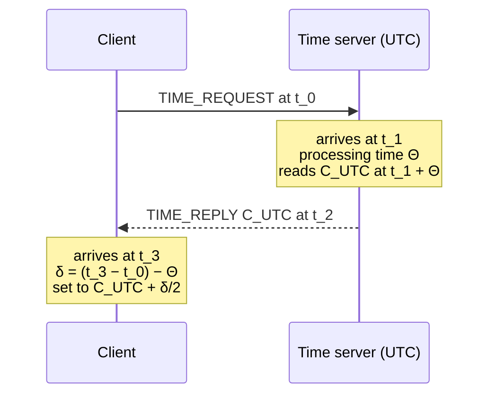

# Cristian's Algorithm

**External synchronization** against a time server.

- a **time server on a UTC basis**
- **goal: external synchronization with a time server**
- **every computer `R_i` regularly sends a request for the current clock time to the time
  server; the latter sends its time `C_UTC` back**

## The four timestamps

| Symbol | Meaning |
|---|---|
| `t₀` | **the instant at which the request is sent off** |
| `t₁` | the instant the request arrives at the server |
| `t₂` | the instant the server sends the reply |
| `t₃` | **the instant at which the answer arrives** |
| `Θ` | **the time for processing the request** — `C_UTC` is read **at instant `t₁ + Θ`** |

- **processing time** `Θ = t₂ − t₁`
- **total round-trip time** `δ = (t₃ − t₀) − Θ`

## The correction

> [!theorem]
> The algorithm **is based on the assumption that the transit times `t₁ − t₀` and
> `t₃ − t₂` are equal**, hence the **correction time is `δ/2`**.
>
> **The client receives the timestamp `C_UTC` and sets its time to**
>
> ```text
> C(t) = C_UTC + δ/2
> ```

- **if `Θ` is unknown, then set `Θ = 0`** (the round trip then absorbs the server's
  processing time)
- **improvement: carry out many requests; the one that comes back fastest is considered the
  most accurate**

## Pseudocode

```text
state:
    (none persistent — each round is independent)

on synchronize():                          # executed by client p_i
    t_0 ← local_clock()
    send ⟨TIME_REQUEST⟩ to the time server
    wait for ⟨TIME_REPLY, C_UTC, Θ⟩
    t_3 ← local_clock()
    if Θ is unknown:
        Θ ← 0
    δ ← (t_3 − t_0) − Θ                    # time actually spent on the wire
    adjust local clock towards C_UTC + δ/2 # never assign — see clock-correctness

on improved_synchronize(k):                # the suggested improvement
    best ← ⊥
    repeat k times:
        r ← one round of synchronize(), recording δ
        if best = ⊥ or r.δ < best.δ:
            best ← r                       # smallest δ ⇒ least uncertainty
    adjust local clock towards best.C_UTC + best.δ/2
```

## Message flow



## Analysis

**Assumptions:**
- **the outward and return transit times are equal** (`t₁ − t₀ = t₃ − t₂`). This is the
  critical assumption and the source of the algorithm's main weakness.
- the time server is reachable and holds correct UTC.
- `Θ` is either reported by the server or assumed to be 0.

**Message complexity:** 2 messages per client per synchronization round; `2k` for the
improved variant.

**Time complexity:** one round trip.

**Accuracy:** bounded by the *asymmetry* of the two transit times, not by `δ` itself. If
one direction takes `δ/2 + e` and the other `δ/2 − e`, the resulting error is `e`. The
"take the fastest round trip" improvement works because a small `δ` leaves little room for
a large asymmetry.

**Failure behaviour:**
- Lost request or reply ⇒ the round simply times out and is repeated; no harm, because each
  round is self-contained and stateless.
- **Time-server failure ⇒ no synchronization at all.** The server is a single point of
  failure and a bottleneck — see the shared criticism on
  [[algorithms/berkeley-algorithm]].

> [!warning]
> **Weakness (exercise 5.2): asymmetric latency.** The algorithm cannot detect that the two
> directions took different times, so it cannot bound its own error. Nothing in the
> protocol reveals the asymmetry.

> [!exam]
> Three things get asked: the formula `C(t) = C_UTC + δ/2`, the definition
> `δ = (t₃ − t₀) − Θ`, and the **assumption that makes the halving legitimate**. Give the
> assumption unprompted — it is the point of the question.

## Related
- [[concepts/clock-synchronization]]
- [[algorithms/berkeley-algorithm]]
- [[concepts/network-time-protocol]]
- [[concepts/clock-correctness]]
- [[exercises/ex05-storage-and-clock-synchronization]]
- [[chapters/05-distributed-resources-and-synchronization]]
