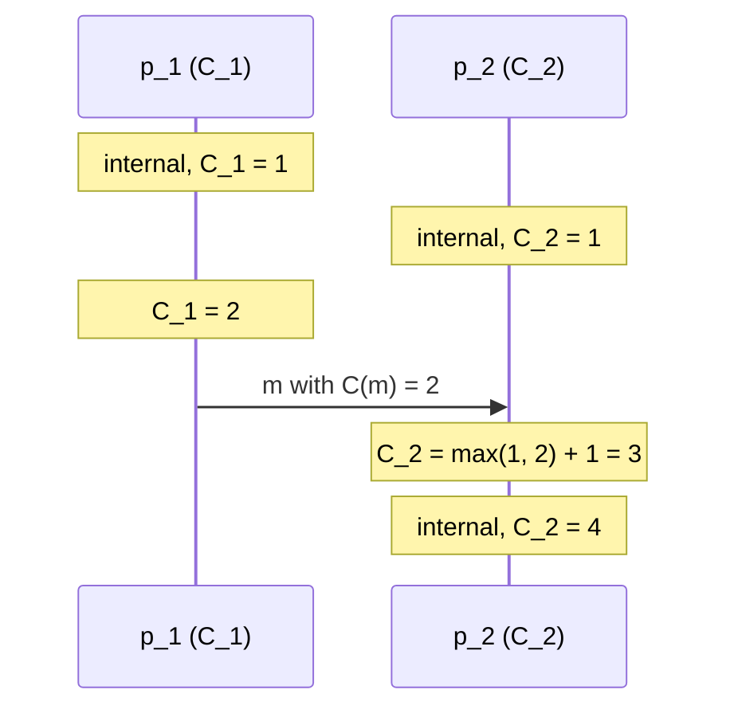

# Lamport Timestamps

The standard implementation of a [[concepts/logical-clock]].

**Every computer `R_i` has a logical clock `C_i`, with `C_i = 0` at start. Depending on the
type of the event, a new timestamp is generated.**

## The three rules

| Event | Action |
|---|---|
| **internal event** | **`R_i` increments its logical clock: `C_i++`** |
| **sending a message `m`** | **the sending computer `R_i` increments its logical clock and attaches the new value of `C_i` to the message `m` as `C(m)`** |
| **receiving a message `m`** with attached `C(m)` | **the receiving computer `R_j` updates its logical clock according to `C_j = max(C_j, C(m)) + 1`** |

> [!theorem]
> **The Lamport timestamp algorithm assigns to every event `e` a numeric timestamp `C(e)`
> such that from `a → b` it follows that `C(a) < C(b)`.**

## Pseudocode

```text
state (at computer p_i):
    C_i ← 0

on internal_event():
    C_i ← C_i + 1

on send(m, p_j):
    C_i ← C_i + 1
    attach C(m) ← C_i to m
    send m to p_j

on receive(m) from p_j:
    C_i ← max(C_i, C(m)) + 1
```



## Extension to a total order

**By means of an extension, a total order of all events in a distributed system is
achieved.**

- **prerequisite: the computers have unique IDs**
- **the timestamp is a pair `(Lamport time, computer ID)`**
- the comparison is **lexicographic**:

  ```text
  (L_i, R_1) < (L_j, R_2)   ⟺   L_i < L_j   or   (L_i = L_j and R_1 < R_2)
  ```

- **thereby every event receives a unique timestamp**

> [!warning]
> **The clock can overflow** (*Uhr kann überlaufen*).

## Analysis

**Assumptions:**
- every computer has a unique ID (for the total-order extension).
- counters are unbounded in principle — in practice see the overflow warning.
- no assumption whatsoever about physical clocks, message delays or process speeds.

**Message complexity:** **zero additional messages.** The timestamp rides along on messages
that were being sent anyway; the overhead is one integer per message.

**Space complexity:** O(1) per computer — a single counter.

**Failure behaviour:** a crashed computer simply stops generating events. Timestamps of
surviving computers remain valid, because the invariant is maintained locally and per
message. The algorithm is unaffected by lost messages, except that the causal chain through
a lost message never forms.

> [!warning]
> **The converse does not hold.** `C(a) < C(b)` does **not** imply `a → b` — this is stated
> explicitly as the motivation for [[algorithms/vector-clocks|vector clocks]]. A scalar
> cannot distinguish "`b` learned about `a`" from "`b` just happens to have counted
> higher".

> [!inference]
> The `+1` on receive is what makes the inequality **strict**. Taking merely
> `C_j = max(C_j, C(m))` would let the receive event carry the same timestamp as the send
> event, breaking `C(a) < C(b)` for the one pair the rule exists to serve.

> [!inference]
> The total-order extension is a **tie-break, not more information**. It makes timestamps
> unique, which is what [[algorithms/totally-ordered-multicast]] needs to build a
> deterministic queue order — but the order it imposes on concurrent events is **arbitrary**.
> Every computer makes the *same* arbitrary choice, and for the multicast application that
> is precisely enough.

> [!exam]
> The three rules and `C_j = max(C_j, C(m)) + 1` are the most quotable items in the
> chapter. Add the one-sentence limitation — implication in one direction only — because it
> is the standard follow-up question.

## Related
- [[concepts/logical-clock]]
- [[concepts/causality]]
- [[algorithms/vector-clocks]]
- [[algorithms/totally-ordered-multicast]]
- [[chapters/05-distributed-resources-and-synchronization]]
