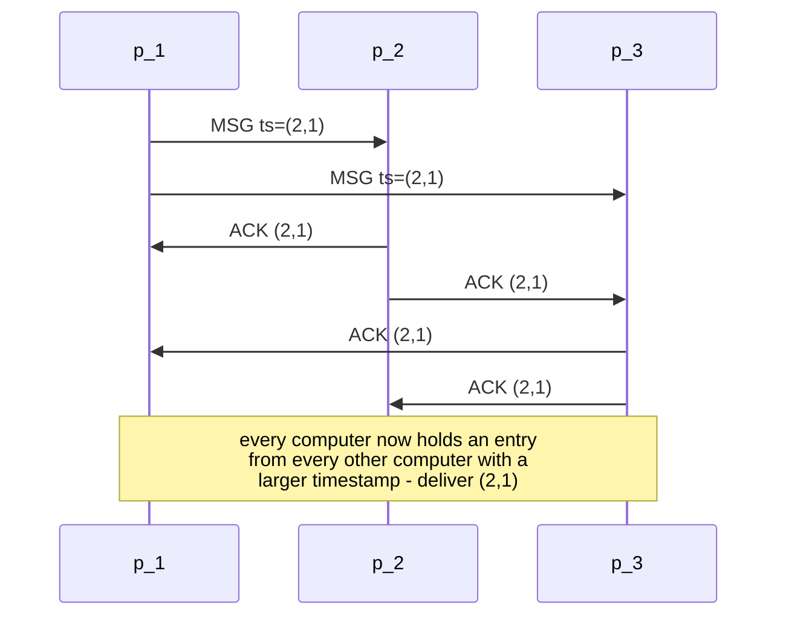

# Totally Ordered Multicast

*Vollständig sortierter Multicast.* The application that motivates
[[algorithms/lamport-timestamps|Lamport's total order]].

## The requirement it serves

The summary introduces it with a **bank-account requirement** (*Bankkontoanforderung*):

> **all operations must be carried out on every computer in the same order.**

The sketch in the source shows the classic failure: two updates — say *add interest* and
*deposit* — sent concurrently to two replicas, arriving in opposite orders, leaving the two
replicas with different balances.

> [!definition]
> With **totally ordered multicast**, computers of a computer group can **send messages to
> all members. Messages are delivered at all participants in the same order**, i.e. **if
> one computer delivers a message `m₁` before it delivers `m₂`, then every other computer
> that delivers `m₂` also delivers `m₁` before `m₂`.**

## Assumptions

1. **messages are not lost**
2. **messages from one computer `A` to a computer `B` arrive in the same order in which
   they are sent**
3. **the number of participating computers is known**

## The protocol

- **all messages contain the unique Lamport timestamp (with computer ID) of the send
  event**
- **messages are always sent to everyone and managed in a queue according to their
  timestamp**
- **the receiver sends an acknowledgement to everyone; these also go into the queue**
- a computer **passes a message to the application exactly when**
  1. **the message is at the head of the queue, and**
  2. **a message with a larger timestamp is in the queue from every other computer**
- **after delivery, the message and all associated acknowledgement messages are removed
  from the queue**

## Pseudocode

```text
state (at computer p_i):
    C_i      ← 0                    # Lamport clock with ID tie-break
    queue    ← empty priority queue ordered by ⟨timestamp, computer ID⟩
    N        ← number of participating computers

on multicast(payload):
    C_i ← C_i + 1
    ts  ← ⟨C_i, i⟩
    send ⟨MSG, ts, payload⟩ to all computers (including p_i)

on receive ⟨MSG, ts, payload⟩ from p_j:
    C_i ← max(C_i, ts.time) + 1
    insert ⟨MSG, ts, payload, from = p_j⟩ into queue
    send ⟨ACK, ts⟩ to all computers

on receive ⟨ACK, ts⟩ from p_k:
    insert ⟨ACK, ts, from = p_k⟩ into queue

on queue changed:
    while deliverable(head(queue)):
        m ← remove head(queue)
        remove all ACKs belonging to m from queue
        deliver m.payload to the application

function deliverable(m):
    return m is a MSG
       and m is at the head of queue
       and for every other computer p_k:
               queue contains an entry from p_k with a timestamp > m.ts
```

## Message flow



## Analysis

**Assumptions:** the three listed above — no message loss, FIFO per sender pair, known group
size. All three are load-bearing; see the failure notes.

**Message complexity:** `N` messages for the multicast plus `N` acknowledgements from each
of `N` receivers, i.e. **O(N²) messages per multicast**.

**Time complexity:** two message rounds before delivery — the message itself, then the
acknowledgements.

**Failure behaviour:**
- **a single crashed computer blocks delivery everywhere.** The condition *"a message with
  a larger timestamp from **every** other computer"* can never become true again, so every
  queue stalls. The protocol is **not fault-tolerant** — compare
  [[algorithms/two-phase-commit]], which blocks for exactly the same structural reason.
- a lost message violates assumption 1 and has the same effect.

> [!inference]
> Why the acknowledgements are necessary: the queue must know that **no message with a
> smaller timestamp can still arrive**. A computer cannot conclude that from its own state,
> because a slow computer may still be about to send something older. Requiring a
> *later-timestamped entry from every participant* is what makes the head of the queue
> provably final — and the acknowledgement is simply the cheapest way to produce such an
> entry when a computer has nothing to say. It is a **liveness device**, not a reliability
> device.

> [!inference]
> This is why assumption 3 (known group size) is in the list. The delivery condition
> quantifies over *every other computer*, so the protocol must know how many there are.
> That makes the algorithm unsuitable for open or dynamic groups — a
> [[models/centralized-and-decentralized-architectures|peer-to-peer]] setting with joining
> and leaving members breaks it immediately.

> [!exam]
> Give the delivery condition as **two** conjuncts — head of queue **and** a
> larger-timestamped entry from every other computer. Dropping the second is the usual
> mistake, and it is the half that does the work.

## Related
- [[algorithms/lamport-timestamps]]
- [[concepts/causality]]
- [[concepts/causal-ordering]]
- [[concepts/replication]]
- [[algorithms/two-phase-commit]]
- [[chapters/05-distributed-resources-and-synchronization]]
