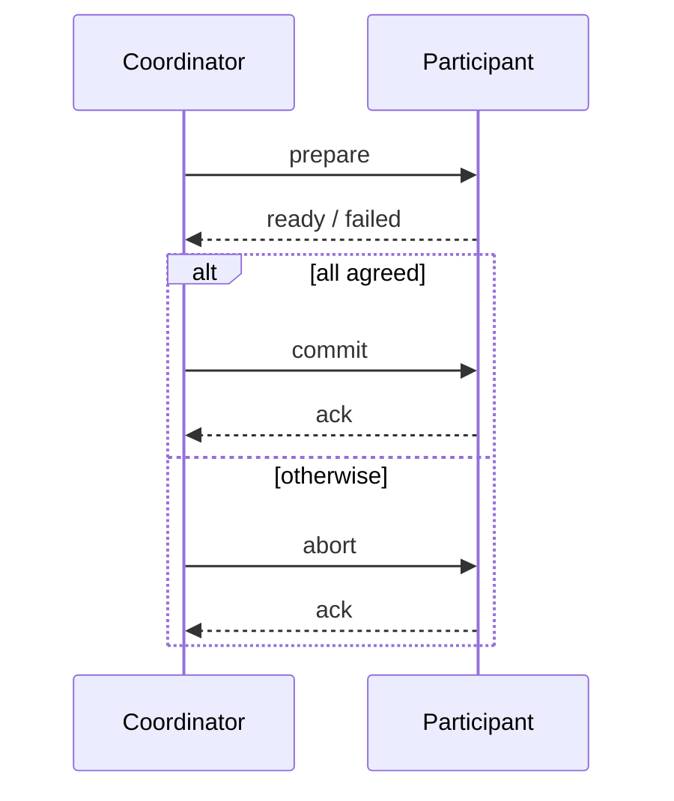
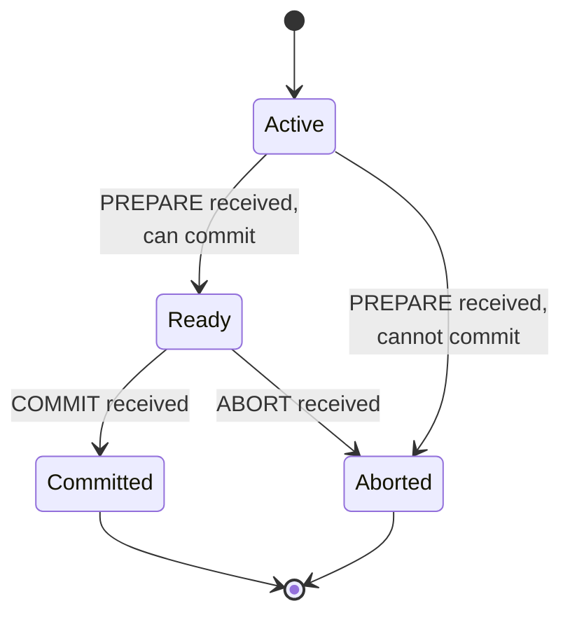

# Two-Phase Commit Protocol (2PC)

2PC makes a transaction spanning several machines atomic: either every participant commits,
or every participant aborts. A dedicated **coordinator** drives the decision in two rounds.

## Transactions

> [!definition]
> A **transaction** is a group of **logically connected data operations**. It is executed
> **either completely or not at all**. If an error occurs, **all actions are undone**
> (*rückgängig gemacht*) — **no error ⇒ commit**.

A **distributed transaction** is carried out by the coordinator.

## The two phases

| Phase | What happens |
|---|---|
| **Phase 1** | Agreement or rejection of the transaction by **all participating machines**. If **all agree ⇒ commit**, otherwise ⇒ **abort**. |
| **Phase 2** | Transmission of the result to all participants. Each participant performs a **commit** or **abort** locally, and **afterwards informs the coordinator**. |

## Pseudocode

```text
# Coordinator C, participants p_1 … p_n
state: votes ← ∅, decision ← ⊥

on begin_commit():
    # ---- Phase 1 ----
    for each p_i:
        send ⟨PREPARE⟩ to p_i
    when votes received from all p_i:
        if ∀ i : votes[i] = READY:
            decision ← COMMIT
        else:
            decision ← ABORT
    # ---- Phase 2 ----
    for each p_i:
        send ⟨decision⟩ to p_i
    when ACK received from all p_i:
        forget transaction


# Participant p_i
state: local ← ACTIVE

on receive(⟨PREPARE⟩) from C:
    if local work can be committed:
        write undo/redo records to log      # makes the vote irrevocable
        local ← READY
        send ⟨READY⟩ to C
    else:
        local ← ABORTED
        send ⟨FAILED⟩ to C

on receive(⟨COMMIT⟩) from C:
    commit locally
    send ⟨ACK⟩ to C

on receive(⟨ABORT⟩) from C:
    roll back using the log                 # see "recovery" below
    send ⟨ACK⟩ to C
```

**Assumptions:** one designated coordinator; a persistent log at every participant; messages
may be lost; nodes may crash.
**Message complexity:** `2n + 2n = 4n` messages for n participants — PREPARE, vote, decision,
ACK, each once per participant.
**Time complexity:** two round trips.
**Failure behavior:** blocking — see the failure analysis below.

## Sequence


*The two phases. The `alt` block is the broadcast of the decision.*


*Participant state machine. `Ready` is the dangerous state: the participant has given up the
right to decide for itself.*

## Recovery

> **How can the old state be restored?** The **participants look into the log** and thereby
> **reset the variables**.

## Failure cases

| Failure | Consequence |
|---|---|
| **Coordinator crashes** before receiving all replies | the **participants block** and remain blocked |
| **Participant crashes**, i.e. the coordinator receives no reply to `prepare` | the **coordinator blocks** |
| **Lost message** | blocks the coordinator **and/or** the participant |

> [!exam]
> This is the standard criticism of 2PC: it is a **blocking** protocol. A participant in the
> `Ready` state that loses contact with the coordinator can neither commit nor abort on its
> own, because it does not know what the others voted. Connect this to the "independent
> failures" and "deadlocks" problems in [[concepts/distributed-system]].

## When is the outcome correct if no failure occurs?

**All agreed ⇒ the coordinator commits ⇔ every participant performs a local commit.**
Atomicity holds exactly in this case.

## Example of a real distributed transaction

A **bank transfer** executed against the database system of the sender's bank and the
database system of the recipient's bank. If the money transfer to the second bank fails, the
money must be written back to the sender.

## Worked examples
- [[exercises/ex02-foundations-and-2pc]] (task 2.4)

## Related
- [[concepts/distributed-system]]
- [[concepts/synchronous-communication]]
- [[concepts/persistent-data-storage]]
- [[concepts/replication]]
- [[concepts/call-semantics]]
- [[algorithms/totally-ordered-multicast]]
- [[chapters/02-foundations-of-distributed-systems]]
