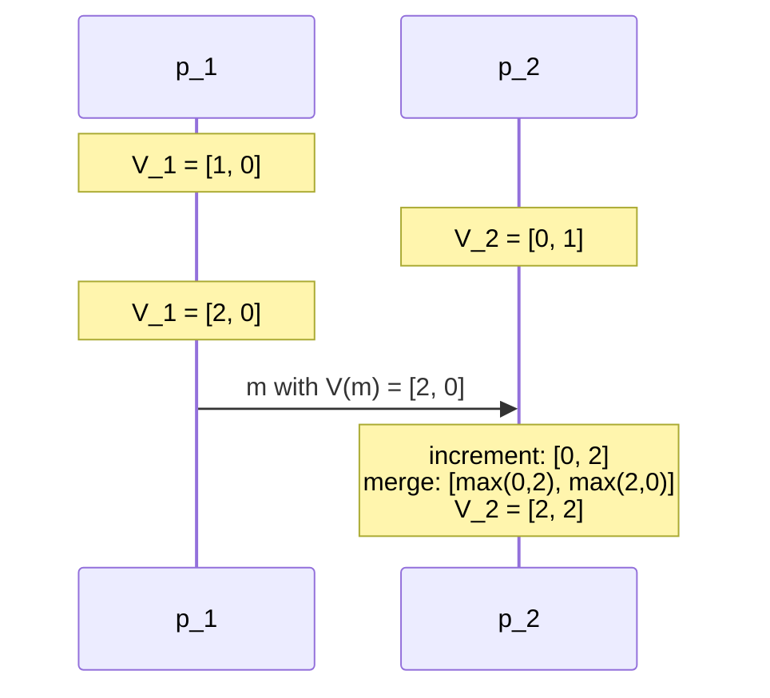

# Vector Clocks

## Why

> **Lamport clocks have the disadvantage that from `C(a) < C(b)` one cannot conclude
> `a → b`.**
>
> **For vector clocks it holds that:**
>
> ```text
> a → b   ⟺   C(a) < C(b)
> ```

**Idea: the timestamp is no longer a single number but a vector whose components contain
the logical times of all computers. With every message, the information held at the sender
about the clocks of all computers is exchanged.**

**Implementation: computer `R_i` manages a vector `V_i`. The number of components
corresponds to the number of computers.**

## The four rules

1. **at the start of computer `R_i`, `V_i[k] = 0` for all computers `R_k`**
2. **at every event of `R_i` (internal event, send, receive), `R_i` increments its vector
   clock: `V_i[i] = V_i[i] + 1`**
3. **when sending a message `m`, `R_i` additionally to (2) attaches the incremented value
   of `V_i` to the message `m` as `V(m)`**
4. **when receiving a message `m` with value `V(m)`, the receiving computer `R_i`
   additionally to (2) updates all components `k` of its vector clock as
   `V_i[k] = max(V_i[k], V(m)[k])`**

## Pseudocode

```text
state (at computer p_i, in a group of n computers):
    V_i[k] ← 0   for k = 1 … n

on internal_event():
    V_i[i] ← V_i[i] + 1

on send(m, p_j):
    V_i[i] ← V_i[i] + 1
    attach V(m) ← V_i to m
    send m to p_j

on receive(m) from p_j:
    V_i[i] ← V_i[i] + 1
    for k = 1 … n:
        V_i[k] ← max(V_i[k], V(m)[k])
```

> [!inference]
> **Why incrementing *before* merging is safe.** It looks dangerous: the merge writes
> component `i` too, so it could seemingly undo the increment on the line above. It cannot.
> `V(m)[i]` is the *sender's* knowledge of how many events have happened at `p_i`, and that
> knowledge can only have reached `p_j` through earlier messages from `p_i`. So
> `V(m)[i] ≤ V_i[i]` always holds before the increment, hence `V(m)[i] < V_i[i]` after it,
> and `max` keeps the incremented value. The two orders — increment-then-merge (the source's
> rule 4) and merge-then-increment — are therefore equivalent here.



## What the components mean

1. **`V_k[k]` is the number of events that have occurred so far at computer `R_k`**
2. **computer `R_k` knows that at computer `R_j` at least `V_k[j]` events have occurred so
   far**
   - 2.1 **at `R_j` possibly more events have occurred, but no information about this has
     yet arrived at `R_k`**

> [!inference]
> The asymmetry in point 2 is the whole mechanism. Own component = **exact**; foreign
> components = **a lower bound, namely everything I have heard about**. A vector clock is
> therefore literally a record of *what this computer could possibly know*, and comparing
> two such records answers "could `a` have influenced `b`?" — which is the definition of
> [[concepts/causality|`→`]]. That is why the equivalence holds here and not for
> [[algorithms/lamport-timestamps|scalars]]: a scalar compresses `n` independent lower
> bounds into one number and loses exactly the information needed.

## Comparing vector timestamps

> [!definition]
> - **`C(a) = C(b)` ⟺ for all `i`: `C(a)[i] = C(b)[i]`**
> - **`C(a) ≤ C(b)` ⟺ for all `i`: `C(a)[i] ≤ C(b)[i]`**

**The temporal relationship between `a` and `b` can be read off from the timestamps:**

- **`a → b` ⟺ `C(a) ≤ C(b)`**
- **`a ‖ b` ⟺ `¬(C(a) ≤ C(b))` and `¬(C(b) ≤ C(a))`**

> [!inference]
> Concurrency shows up as **incomparability**, not as equality — the vectors "cross", each
> being larger in some component and smaller in another. This is the formal reason the
> relation is a *partial* order: `≤` on vectors genuinely has incomparable elements, which
> a total order on numbers cannot represent. The data structure now has the same shape as
> the thing it models.

## Simplified vector clocks for applications

> **A simplified form of the vector clocks suffices:**
>
> 1. **`V_i[i]` is incremented only when `R_i` sends a message; the rest stays.**

> [!inference]
> The simplification is justified because internal events are **invisible to everyone
> else** — no other computer can ever observe them, so they cannot participate in a causal
> chain that crosses processes. Counting only sends keeps every cross-process conclusion
> intact while reducing the rate of change. This is the variant used for
> [[concepts/causal-ordering|causal message ordering]].

## Analysis

**Assumptions:** the number of computers `n` is known and fixed (the vector has one
component per computer). No assumptions about physical time or message delays.

**Message complexity:** **zero additional messages** — like Lamport, the data rides along.

**Space / message overhead:** **O(n) per message and per computer**, against O(1) for
Lamport. This is the price of the equivalence.

**Failure behaviour:** unaffected by crashes or lost messages; the invariant is maintained
locally. A crashed computer's component simply stops advancing.

> [!warning]
> The O(n) cost is why vector clocks do not scale to large or dynamic groups, and it is the
> reason Lamport clocks remain in use despite being strictly weaker. The group size must
> also be **known in advance**, as with [[algorithms/totally-ordered-multicast]].

> [!exam]
> The contrast is the examinable point: **Lamport gives `a → b ⇒ C(a) < C(b)`; vector
> clocks give `a → b ⟺ C(a) ≤ C(b)`.** Note the relation symbol changes from `<` to `≤`
> along with the implication becoming an equivalence.

## Related
- [[algorithms/lamport-timestamps]]
- [[concepts/causality]]
- [[concepts/logical-clock]]
- [[concepts/causal-ordering]]
- [[algorithms/totally-ordered-multicast]]
- [[chapters/05-distributed-resources-and-synchronization]]
