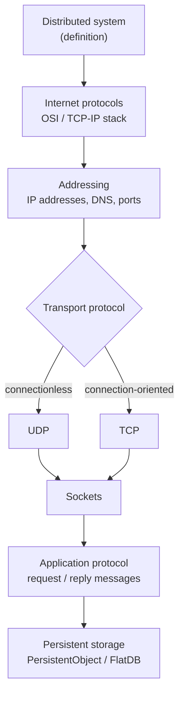

# Chapter 1 — Networking and Socket Programming

How processes on different machines actually exchange bytes: the protocol stack beneath a
distributed system, the two transport protocols that matter (UDP and TCP), and the socket
API that applications program against.

## Scope

This chapter works bottom-up from the network to the application:

*Chapter 1 roadmap: from the network stack up to the application protocol.*

## Contents

1. [[concepts/distributed-system]] — the working definition used throughout the module.
2. [[concepts/osi-model]] — the seven-layer reference model and the internet protocol family.
3. [[concepts/ip-addressing-and-ports]] — IPv4 addresses, DNS, and port numbers.
4. [[concepts/udp]] — datagram-oriented, unreliable, minimal overhead.
5. [[concepts/tcp]] — byte-stream, connection-oriented, reliable, full-duplex.
6. [[concepts/sockets]] — the OS-provided communication endpoint, plus the Java API.
7. [[concepts/application-protocol]] — request/reply message design and packet structure.
8. [[concepts/persistent-data-storage]] — the `PersistentObject` / `FlatDB` abstraction.
9. [[models/client-server-architecture]] — server threading models and layered architectures.

## Key takeaways

> [!definition]
> A system is a **distributed system** if (1) its software components reside on networked
> computers, (2) the components communicate *only* by exchanging messages, and (3) it appears
> to the user as a single coherent system.

- The transport layer offers exactly one real choice: **UDP** (cheap, unreliable) or
  **TCP** (expensive, reliable). Everything else in the application follows from it.
  See the decision table in [[exercises/ex01-tcp-udp-and-sockets]].
- A **socket** is the endpoint abstraction that makes both look like an ordinary I/O object,
  bound to an (IP address, port) pair.
- Because the network carries raw bytes, the application must define its own
  **application protocol**: message types, header layout, and (de)serialization.

## Exercises

- [[exercises/ex01-tcp-udp-and-sockets]]

## Related
- [[chapters/02-foundations-of-distributed-systems]]
- [[overview]]
- [[glossary]]
