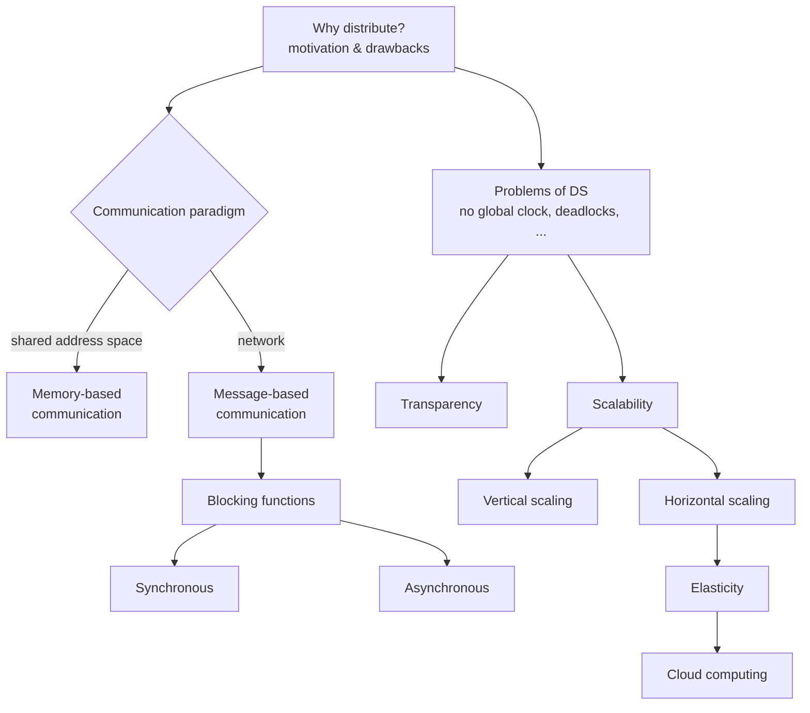

# Chapter 2 — Foundations of Distributed Systems

Why distributed systems are built, what makes them hard, and the two quality properties the
module keeps returning to: **transparency** and **scalability**.

## Scope

*Chapter 2 roadmap.*

## Contents

1. [[concepts/distributed-system]] — definition, motivation, and drawbacks.
2. [[concepts/communication-paradigms]] — memory-based vs. message-based communication.
3. [[concepts/blocking-function]] — the primitive that distinguishes the next two pages.
4. [[concepts/synchronous-communication]] — sender and receiver synchronized; both block.
5. [[concepts/asynchronous-communication]] — buffered; `send` does not block.
6. [[concepts/transparency]] — the six transparency dimensions.
7. [[concepts/scalability]] — definition, vertical vs. horizontal scaling, techniques.
8. [[concepts/speedup]] — the scaling factor; super-/linear/sub-linear.
9. [[concepts/elasticity]] — adaptation at *runtime*.
10. [[concepts/cloud-computing]] — unlimited horizontal scaling as a service.

## Key takeaways

**Motivation for distributing:** resource sharing (physical: disks, CPUs; logical: data),
information exchange, geographically distributed access, virtualization of IT systems,
economy, reliability — and the plain fact that the real world *is* distributed.

**Drawbacks:** new security risks, increased complexity, performance losses.

**Inherent problems** (these recur in every later chapter):

| Problem | Why it hurts |
|---|---|
| No global clock | Events cannot be totally ordered by timestamp |
| Heterogeneous participants | Different hardware, OS, byte order ([[concepts/byte-order]]) |
| Security | The network is an attack surface |
| Concurrency | Interleavings must be controlled |
| Deadlocks | Synchronization across nodes can cycle |
| Independent failures | Parts fail while others keep running |

> [!exam]
> The distinction *distributed system vs. multiprocessor system* is a standard exam question.
> Multiprocessor: shared memory, tight coupling, homogeneous, one global clock.
> Distributed: no shared memory, message passing with an explicit protocol, heterogeneous
> (needs middleware), no global clock. Worked out in [[exercises/ex02-foundations-and-2pc]].

## Exercises

- [[exercises/ex02-foundations-and-2pc]] — includes [[algorithms/two-phase-commit]] and
  [[concepts/byte-order]].

## Related
- [[chapters/01-networking-and-sockets]]
- [[chapters/03-architectures-and-web-systems]]
- [[overview]]
- [[glossary]]
