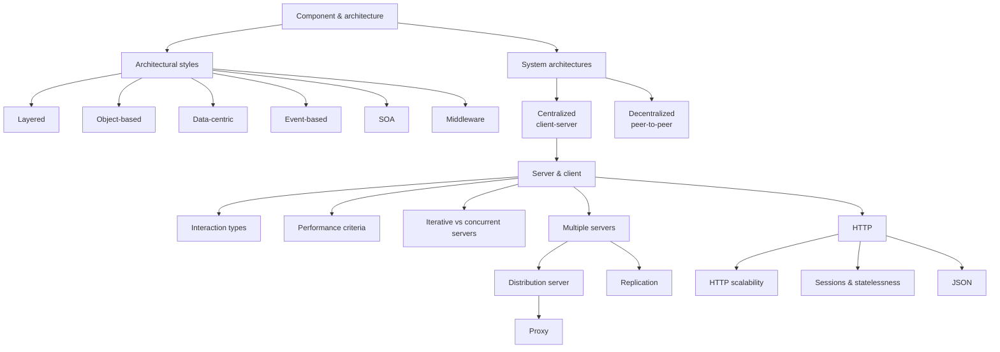

# Chapter 3 — Architectures and Web-Based Systems

How distributed systems are *structured*: the architectural styles available, the middleware
that hides platform differences, the client–server realizations that follow from them, and
the concrete case study the module uses throughout — HTTP and the web.

## Scope

*Chapter 3 roadmap.*

## Contents

**Architecture fundamentals**
1. [[concepts/software-architecture]] — component and architecture definitions.
2. [[models/architectural-styles]] — layered, object-based, data-centric, event-based.
3. [[concepts/pull-and-push-style]] — who controls the information flow.
4. [[models/centralized-and-decentralized-architectures]] — client–server vs. peer-to-peer.
5. [[concepts/service-oriented-architecture]] — decomposition by function, orchestration.
6. [[concepts/middleware]] — the application-neutral layer that hides platform differences.

**Client–server realization**
7. [[concepts/server-and-client]] — the two role definitions.
8. [[concepts/persistent-and-transient-communication]] — how long the system stores a message.
9. [[concepts/interaction-types]] — synchronous, asynchronous, deferred synchronous, one-way.
10. [[concepts/performance-criteria]] — response time, throughput, latency, jitter, QoS, SLA.
11. [[concepts/iterative-and-concurrent-servers]] — sequential vs. concurrent request handling.
12. [[concepts/distribution-server]] — one address in front of many servers.
13. [[concepts/replication]] — distributed vs. replicated data; synchronous vs. asynchronous.
14. [[concepts/proxy]] — a representative that controls access to a component.
15. [[concepts/fat-and-thin-clients]] — where the application logic lives.
16. [[concepts/libraries-frameworks-and-containers]] — reuse, inversion of control, containers.

**The web as a case study**
17. [[concepts/http]] — the generic client–server protocol.
18. [[concepts/http-scalability]] — HTTP/1.0 problems, HTTP/1.1 fixes, HTTP/2.
19. [[concepts/sessions-and-statelessness]] — how a stateless protocol carries state anyway.
20. [[concepts/json]] — the data interchange format used for parameters.

## Key takeaways

> [!definition]
> The **architecture** of a system describes its decomposition into separate components and
> defines their functional roles, their relationships, how they communicate, and how they are
> mapped onto a network of computers.

- The central tension of the chapter is **coupling**. Layered and object-based styles couple
  tightly (direct calls); data-centric and event-based styles couple loosely (shared space,
  messages). SOA is explicitly a move toward loose coupling.
- **Middleware exists because the hard problems — heterogeneity, fault tolerance,
  scalability — are independent of any particular application** and should not be solved
  again for every one of them.
- **HTTP is stateless**, yet web applications need state. The whole of
  [[concepts/sessions-and-statelessness]] is about resolving that contradiction, and it is
  where the module's privacy discussion lives.

## Exercises

- [[exercises/ex03-architectures-and-http]]

## Related
- [[chapters/02-foundations-of-distributed-systems]]
- [[chapters/04-remote-invocation]]
- [[overview]]
- [[glossary]]
