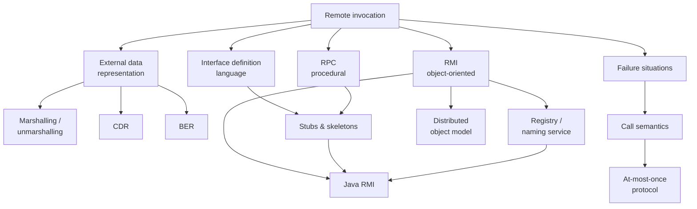

# Chapter 4 — Remote Invocation (RPC and RMI)

Chapter 3 ended with [[concepts/middleware]] promising "remote method calls" as a building
block. This chapter is that promise cashed out: how a function call can cross an address
space, what has to be generated to make it look local, and — crucially — **what it can never
quite hide**.

## Scope

*Chapter 4 roadmap.*

## Contents

1. [[concepts/remote-invocation]] — the definition, and the four ways it differs from a local call.
2. [[concepts/external-data-representation]] — marshalling, unmarshalling, CDR.
3. [[concepts/basic-encoding-rules]] — the type–length–value encoding worked in the exercise.
4. [[concepts/interface-definition-language]] — describing an interface without a language.
5. [[concepts/stubs-and-skeletons]] — the generated code, and call-by-copy/restore.
6. [[concepts/remote-call-failures]] — the six failure situations and how to survive them.
7. [[concepts/call-semantics]] — at-least-once, at-most-once, exactly-once.
8. [[algorithms/at-most-once-rpc]] — duplicate suppression with a reply history.
9. [[concepts/distributed-object-model]] — what object orientation adds.
10. [[concepts/rmi-registry]] — binding objects to names.
11. [[models/java-rmi]] — the concrete Java realization.

## Key takeaways

> [!definition]
> **Remote invocation** (*entfernter Aufruf*) is a technique for realizing inter-process
> communication. It enables the **calling of functions in other address spaces.**

- The design goal is stated twice and is worth internalizing: **the additional execution
  effort should be minimal**, and **in software-engineering terms calls should not differ**
  from local ones. Remote calls are an **emulation of local calls**.
- > [!warning]
  > **Not all aspects can be made transparent.** Pointers cannot cross address spaces,
  > network failures have no local analogue, and — as [[concepts/call-semantics]] shows —
  > **exactly-once semantics is not achievable** in the presence of crashes. This is the
  > single most important result of the chapter.
- The whole chapter is an instance of the [[concepts/proxy]] pattern: the client stub *is* a
  remote proxy, generated rather than hand-written.

## Exercises

- [[exercises/ex04-rpc-rmi-and-ber]]

## Related
- [[chapters/03-architectures-and-web-systems]]
- [[chapters/05-distributed-resources-and-synchronization]]
- [[overview]]
- [[glossary]]
