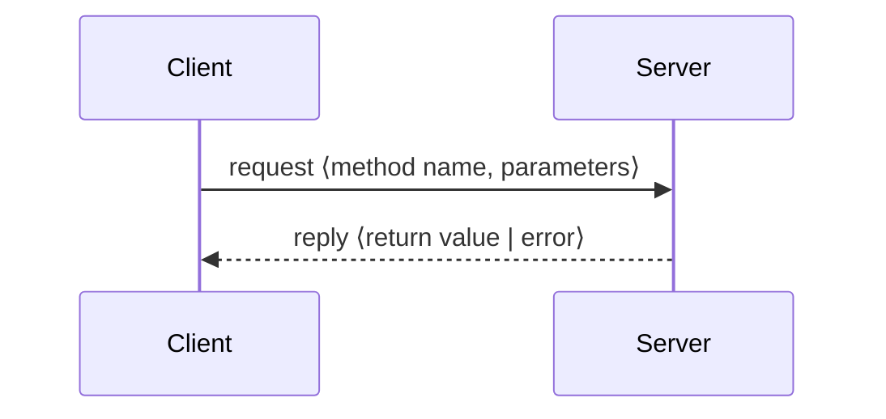

# Application Protocol

Because the transport layer only moves raw bytes, the application must define its own
protocol (*Anwendungsprotokoll*): which messages exist, what they contain, and how they are
encoded as a byte sequence.

## Message types

| Message | Contents |
|---|---|
| **Request** (*Anfrage-Nachricht*) | name of the invoked method; parameters of the method |
| **Reply** (*Antwort-Nachricht*) | return value; error message |


*The request/reply pattern underlying remote method invocation.*

## Packet structure

**All messages share the same header structure.** The header recorded in the summary is four
bytes:

```text
byte:   0        1        2        3
      ┌────────┬────────┬────────┬────────┐
      │ length of body  │  type  │ error  │
      └────────┴────────┴────────┴────────┘
```

- bytes 0–1: **length of the body**
- byte 2: **message type**
- byte 3: **error code**

> [!inference]
> A length field in the header is what makes a message protocol workable on top of
> [[concepts/tcp]], whose byte stream does not preserve message boundaries. The receiver reads
> the fixed-size header first, then exactly *length* further bytes.

## Converting data into a byte stream

Values must be marshalled into and out of byte sequences, for example:

```text
int  ⇄  byte[]
String name ← decodeString(buf)
```

Two related concerns:
- **Common language and common semantics** between the partners — see
  [[concepts/communication-paradigms]].
- **Common byte order** on heterogeneous machines — see [[concepts/byte-order]].

## Related
- [[concepts/sockets]]
- [[concepts/persistent-data-storage]]
- [[concepts/byte-order]]
- [[concepts/http]]
- [[concepts/json]]
- [[chapters/01-networking-and-sockets]]
