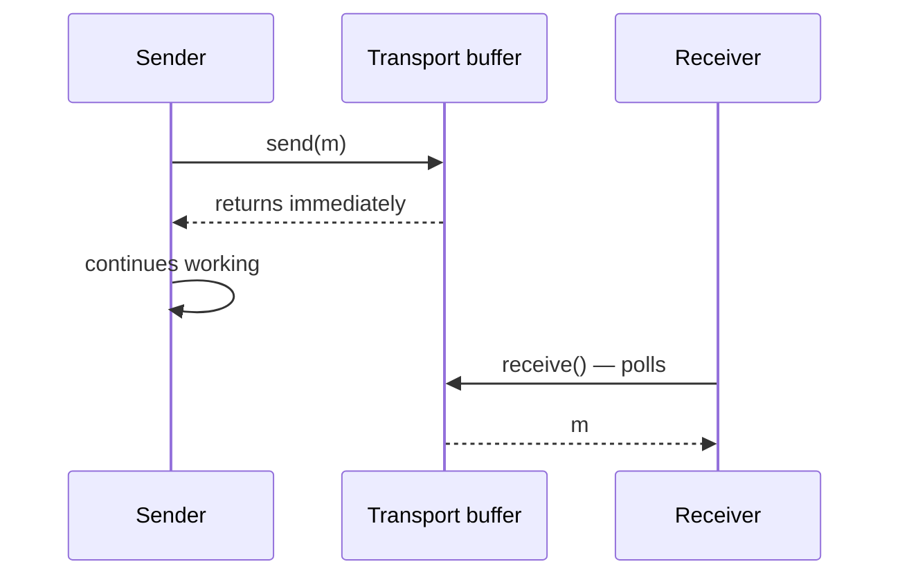

# Asynchronous Communication

Asynchronous communication decouples sender and receiver in time by placing a buffer between
them.

> [!definition]
> **Asynchronous communication** (*asynchrone Kommunikation*) is the form of communication in
> which the sending and the receiving process are **not synchronized**. **Sending is not
> blocking**; receiving *may* block but **need not**.

## Semantics

- The sender blocks **only until `send` returns**.
- `send` returns once the message has been placed in the **transport buffer** of the
  communication system. If that buffer is full, the sender either blocks or is informed via
  an **error code**.
- The sender **does not know whether or when** the message will be read.
- A **non-blocking `receive`** tests whether a message is in the receive buffer:
  - if **yes**, it is removed from the buffer and handed to the application;
  - if **no**, `receive` returns immediately.

## Protocol sketch

```text
# sender p_i
on send(m) to p_j:
    if transport_buffer is full:
        block  OR  return error_code
    append m to transport_buffer
    return                                # p_i continues; delivery not guaranteed yet

# receiver p_j, non-blocking variant
on receive():
    if receive_buffer is empty:
        return ⊥                          # returns immediately
    m ← pop(receive_buffer)
    return m
```

**Assumptions:** buffers are required on **both** the send and the receive side.
**Message complexity:** 1 message plus buffer management.
**Time complexity:** sender proceeds after a local buffer write — no round trip.
**Failure behavior:** the sender does not learn whether the message was accepted; a full
buffer forces blocking after all.


*The buffer breaks the temporal coupling between the partners.*

## Advantages

- **Temporal decoupling** of sender and receiver.
- A **higher degree of parallelism** is possible.
- **Lower risk of communication deadlocks.**

## Disadvantages

- **Buffers are necessary** on both the sending and the receiving side.
- The sender **does not know whether or when** buffer space becomes free at the receiver.
- If the buffers are full, blocking is unavoidable after all.
- The sender **does not know whether the message has arrived**.

## Comparison

| | Synchronous | Asynchronous |
|---|---|---|
| `send` blocks | until the receiver takes the message | only until the message is buffered |
| Buffers | not needed | needed on both sides |
| Parallelism | restricted | higher |
| Deadlock risk | higher | lower |
| Sender knows message was received | yes | no |

> [!exam]
> Asynchronous communication is also listed as one of the **techniques for achieving
> scalability** — see [[concepts/scalability]].

## Worked examples
- [[exercises/ex02-foundations-and-2pc]] (task 2.1/5)

## Related
- [[concepts/synchronous-communication]]
- [[concepts/blocking-function]]
- [[concepts/scalability]]
- [[chapters/02-foundations-of-distributed-systems]]
