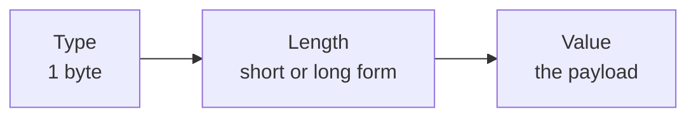

# BER: Basic Encoding Rules

> [!definition]
> **BER** is a **standard for the coding of data structures and type structures.** Every
> value is encoded as a **Type – Length – Value (TLV)** triple.



## The type byte

8 bits, split into three fields:

```text
 7 6   5    4 3 2 1 0
+---+-----+-----------+
|cls| P/C |  data type |
+---+-----+-----------+
  2b   1b      5b
```

| Field | Width | Meaning |
|---|---|---|
| **Class** | **2 bits** | assigns the data type to a **visibility class** — here **`00` = universal** |
| **P/C** | **1 bit** | **`0` = primitive**, **`1` = complex (constructed)** |
| **Data type** | **5 bits** | the type tag itself |

Tags seen in the exercise:

| Tag (5 bits) | Hex type byte | Type |
|---|---|---|
| `00001` | `01h` | Boolean |
| `00010` | `02h` | Integer |
| `00100` | `04h` | Octet string |
| `10000` | `30h` | **Sequence** (complex, so the P/C bit is set) |

## The length field

| Form | Encoding | Meaning |
|---|---|---|
| **Short** | `0` + 7 bits | the **number of bytes in the value field**, directly |
| **Long** | `1` + 7 bits | those 7 bits give **how many following bytes hold the length** as an integer |

```text
decode_length(stream):
    b ← next_byte(stream)
    if b < 0x80:                      # short form, high bit clear
        return b
    else:                             # long form
        k ← b and 0x7F                # number of length bytes that follow
        return integer_from(next k bytes)
```

> [!exam]
> The short form is capped at 127 bytes. `82h` means "the next **2** bytes are the length",
> not "the length is 2" — this is the standard trap.

## Values

- **Integers** are stored in **two's complement**, so the top bit is the sign.
- **Booleans:** `FFh` = true, `00h` = false.
- **Octet strings** carry raw bytes.
- **Sequences** carry further complete TLV triples as their value.

## Worked examples

```text
02h 01h E6h
└┬┘ └┬┘ └┬┘
 │   │   └─ 1110 0110 = −2⁷+2⁶+2⁵+2²+2¹ = −128+64+32+4+2 = −26
 │   └───── length 1 byte
 └───────── Integer

01h 01h FFh          -> Boolean, 1 byte, true
02h 01h 00h          -> Integer, 1 byte, 0
02h 01h 14h          -> Integer 20
02h 01h B0h          -> Integer −80        (0xB0 = 176; 176 − 256 = −80)
04h 03h 01h 23h 45h  -> Octet string '0x01 0x23 0x45'
```

### A nested example

```text
30h 82h 00h 0Ch  02h 01h 0Fh  04h 04h A0h 0Fh 02h 01h  01h 01h 00h
└┬┘ └──┬────┘    └────┬────┘  └────────┬─────────────┘ └────┬────┘
 │     │              │                │                    │
 │     │              │                │                    └ Boolean false
 │     │              │                └ Octet string, 4 bytes: A0 0F 02 01
 │     │              └ Integer 15
 │     └ long form: the next 2 bytes give the length = 0x000C = 12
 └ Sequence (class 00, complex, tag 10000)

check: 3 + 6 + 3 = 12 value bytes  ✓
```

> [!inference]
> Because a Sequence's value is itself a stream of TLVs, BER is **recursive**, and the
> length field makes it **skippable**: a decoder that does not understand a tag can still
> step over it. That is precisely what CDR cannot do — see
> [[concepts/external-data-representation]].

## Related
- [[concepts/external-data-representation]]
- [[concepts/byte-order]]
- [[concepts/json]]
- [[exercises/ex04-rpc-rmi-and-ber]]
- [[chapters/04-remote-invocation]]
