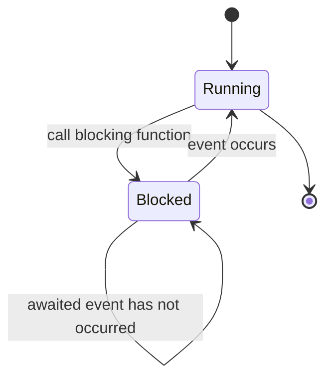

# Blocking Function

A blocking function is the primitive on which the distinction between synchronous and
asynchronous communication rests.

> [!definition]
> A function is called **blocking** (*blockierend*) if it **interrupts the program flow and
> waits for a specific event**, continuing only when that event occurs.


*A blocking call suspends the caller until its awaited event occurs.*

```text
on call blocking_f():
    suspend caller
    when <awaited event> :
        resume caller
```

Non-blocking (*nichtsperrend*) counterparts return immediately and report whether the event
had already happened — the pattern used by asynchronous `receive`, see
[[concepts/asynchronous-communication]].

## Why it matters

- The unreliability of the network means a blocking `receive` may wait **forever**.
  This is why sockets offer `setSoTimeout` — see [[concepts/sockets]].
- Mutual blocking across nodes is one route to the deadlocks listed as an inherent problem of
  distributed systems in [[concepts/distributed-system]].

## Related
- [[concepts/synchronous-communication]]
- [[concepts/asynchronous-communication]]
- [[concepts/communication-paradigms]]
- [[chapters/02-foundations-of-distributed-systems]]
