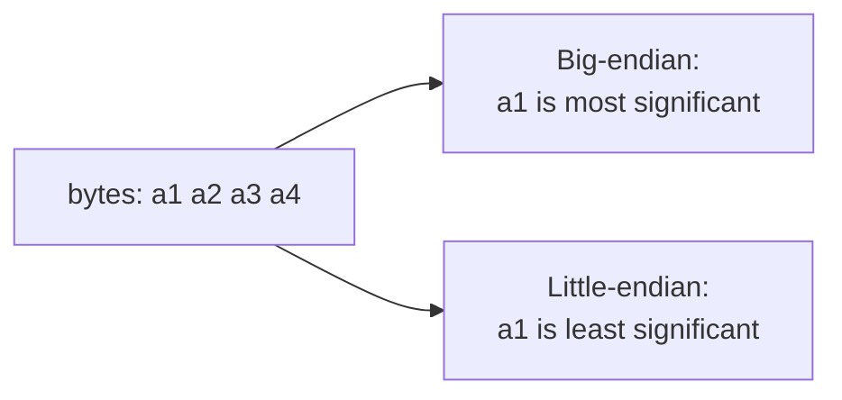

# Byte Order (Endianness)

Heterogeneous machines disagree about which end of a multi-byte integer comes first. Because
a distributed system has no shared memory and no homogeneous hardware, this must be resolved
explicitly on the wire.

> [!definition]
> **Big-endian**: the **"end" comes first** — the most significant byte is stored at the
> lowest address.
> **Little-endian**: the **"beginning" comes first** — the least significant byte is stored
> at the lowest address.

## Reading a 4-byte word

For a word stored as bytes `a₁ a₂ a₃ a₄` (in address order):

```text
decode_big_endian(a₁,a₂,a₃,a₄)    = a₁·2²⁴ + a₂·2¹⁶ + a₃·2⁸ + a₄·2⁰
decode_little_endian(a₁,a₂,a₃,a₄) = a₁·2⁰  + a₂·2⁸  + a₃·2¹⁶ + a₄·2²⁴
```

Method: **first convert each byte to decimal, then weight it** by its position.


*The same four bytes denote two different integers.*

> [!inference]
> A byte sequence is **palindromic** exactly when the two interpretations coincide. The
> exercise uses `0x05 0x06 0x06 0x05`, for which A = B. This is a useful sanity check rather
> than a general rule.

## Network byte order

> `htonl()` — "host to network long" — **converts the unsigned integer `hostlong` from host
> byte order to network byte order.**

Network byte order is the agreed wire convention, so each host converts on the way out and
back on the way in. Companion functions follow the same naming scheme (`htons`, `ntohl`,
`ntohs`).

```text
on send(value):
    transmit htonl(value)        # host → network

on receive(raw):
    return ntohl(raw)            # network → host
```

**Assumptions:** both endpoints use the same conversion convention.
**Message complexity:** none — this is a local transformation.
**Failure behavior:** forgetting the conversion silently yields a byte-swapped number, not an
error.

> [!exam]
> Endianness is the concrete instance of the "heterogeneous participants" problem listed in
> [[concepts/distributed-system]]. In Java this is invisible (the JVM fixes the byte order);
> in the C/C++ practical it is not — see [[concepts/sockets]].

## Worked examples
- [[exercises/ex02-foundations-and-2pc]] (task 2.3)

## Related
- [[concepts/application-protocol]]
- [[concepts/sockets]]
- [[concepts/distributed-system]]
- [[concepts/external-data-representation]]
- [[chapters/02-foundations-of-distributed-systems]]
