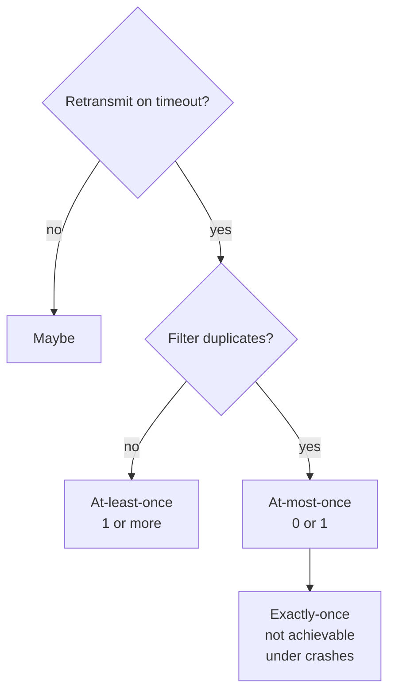

# Call Semantics

> [!definition]
> The **call semantics** (*Aufrufsemantik*) of an RPC **describes which guarantees are made
> to the client regarding the execution of a procedure in certain failure cases.**

## The three (and a half) levels

| Semantics | Guarantee | Achieved by |
|---|---|---|
| **Maybe** | none | fire and forget, no retransmission |
| **At-least-once** (*mindestens einmal*) | the procedure ran **one or more** times | retransmit on timeout, **no** duplicate filtering |
| **At-most-once** (*höchstens einmal*) | the procedure ran **zero or one** times | retransmit **plus** duplicate filtering — see [[algorithms/at-most-once-rpc]] |
| **Exactly-once** (*genau einmal*) | the procedure ran **exactly once** | — |



```text
at_least_once : executions ∈ {1, 2, 3, …}     # never zero, may repeat
at_most_once  : executions ∈ {0, 1}           # never repeats, may be zero
exactly_once  : executions = 1                # the union of both guarantees
```

## When each is acceptable

- **At-least-once** is safe only for **idempotent** operations — re-running `getBalance()`
  is harmless; re-running `transfer(100)` is not.
- **At-most-once** never corrupts state but may silently do nothing, so the client must be
  able to detect and cope with "it didn't happen".

> [!warning]
> **Exactly-once is not achievable in the presence of crashes.**
>
> The client can only observe whether it received an answer; it can never observe whether
> the procedure ran. Exercise 4.6 in [[exercises/ex04-rpc-rmi-and-ber]] proves this
> exhaustively: across the six possible interleavings of *print started* (P), *done message*
> (F) and *crash* (C), **no retry strategy yields exactly one execution in every column.**
>
> The source marks exactly-once with a smiley — it is the semantics everybody wants and
> nobody gets.

### The exercise 4.6 result in one table

Entries are the number of times the job is actually executed.

| Client retry strategy | PFC | PC(F) | C(PF) | C(FP) | FC(P) | FPC |
|---|---|---|---|---|---|---|
| a) always | 2 | 2 | 1 | 1 | 1 | 2 |
| b) never | 1 | 1 | 0 | 0 | 0 | 1 |
| c) only if "done" was received | 2 | 1 | 0 | 0 | 1 | 2 |
| d) only if "done" was **not** received | 1 | 2 | 1 | 1 | 0 | 1 |

> [!exam]
> **Every row contains a value other than 1.** Strategies (a) and (b) fail by construction;
> (c) and (d) each fix one ordering of P and F and break the other. The lesson is that the
> *ordering* of the side effect and the acknowledgement is not something the client can
> know.

> [!inference]
> This is the same impossibility as the blocking of [[algorithms/two-phase-commit]], seen
> from the other side. 2PC blocks rather than guess; RPC guesses rather than block. Neither
> can do both.

## Related
- [[concepts/remote-call-failures]]
- [[algorithms/at-most-once-rpc]]
- [[algorithms/two-phase-commit]]
- [[concepts/remote-invocation]]
- [[exercises/ex04-rpc-rmi-and-ber]]
- [[chapters/04-remote-invocation]]
