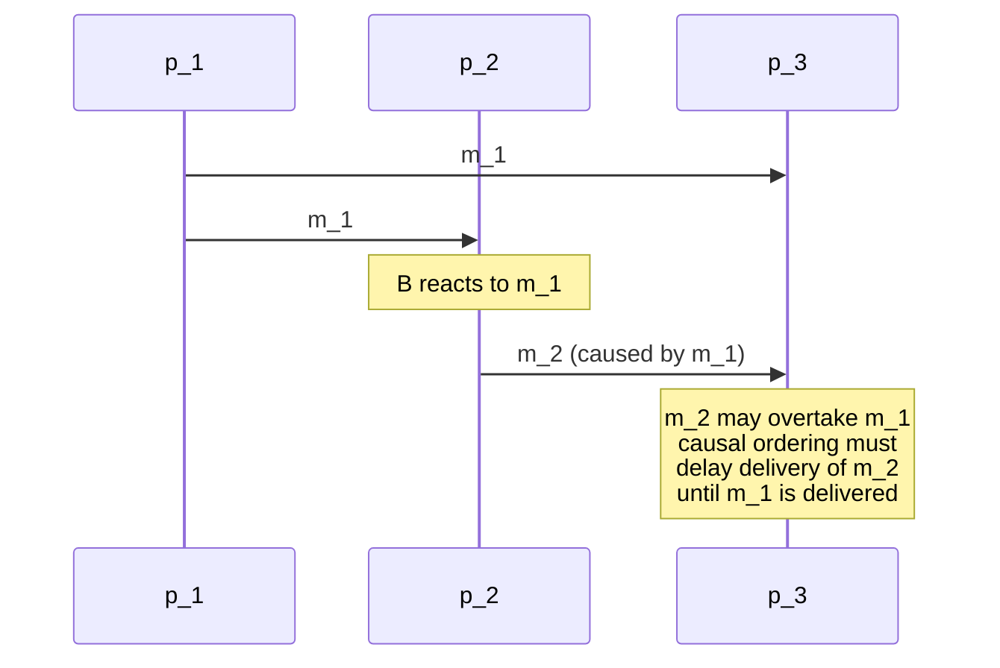

# Causal Ordering

> [!definition]
> **Messages in a distributed system are causally ordered on delivery if receive events
> have the same order as send events.**

Formally, using the [[concepts/causality|happened-before relation]]:

```text
send(m_1) → send(m_2)   ⇒   receive(m_1) → receive(m_2)
```

**Realized with [[algorithms/vector-clocks|vector clocks]]** — specifically the
[[algorithms/vector-clocks|simplified form]], in which the own component is incremented
only on send.



> [!inference]
> The classic failure this prevents is the **reply arriving before the question**: `p_1`
> posts a message, `p_2` reads it and posts a response, and `p_3` — on a faster link from
> `p_2` — sees the response first. No clock can fix this, because the problem is not that
> `p_3` has the wrong time; it is that `p_3` delivered in an order that contradicts `→`.

> [!inference]
> Note how this differs from [[algorithms/totally-ordered-multicast]], which is easy to
> confuse with it:
>
> | | Totally ordered multicast | Causal ordering |
> |---|---|---|
> | Guarantees | **all** receivers use the **same** order | the order respects `→` |
> | Says anything about concurrent messages? | yes — forces an arbitrary common order | **no** — they may be delivered in any order |
> | Built on | [[algorithms/lamport-timestamps]] + ID | [[algorithms/vector-clocks]] |
> | Cost | O(N²) messages, blocks on one crash | O(n) per message, no extra messages |
>
> Total order is **stronger for concurrent messages** and **says nothing extra about
> causally related ones**; causal order is the opposite. Neither implies the other.

> [!exam]
> Give the definition as an implication between two `→` statements — on sends on the left,
> on receives on the right — and name vector clocks as the mechanism.

## Related
- [[concepts/causality]]
- [[algorithms/vector-clocks]]
- [[algorithms/totally-ordered-multicast]]
- [[algorithms/lamport-timestamps]]
- [[concepts/synchronization]]
- [[chapters/05-distributed-resources-and-synchronization]]
