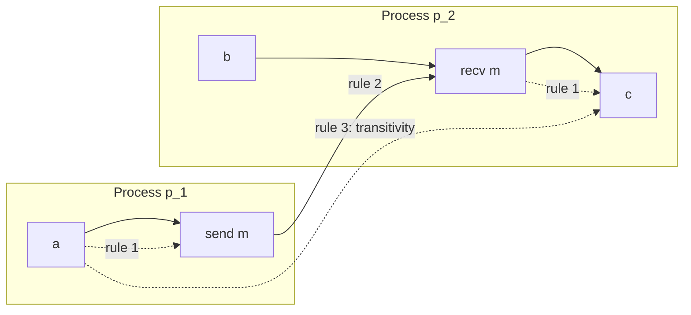

# Causality and the Happened-Before Relation

The pivot of the chapter: the realization that distributed algorithms do not actually need
**real time**, they need **order** — and order can be captured exactly.

> [!definition]
> **Causality** (*Kausalität*) is the **relationship between cause and effect; it concerns
> the sequence of events. An event `A` is the cause of an event `B` if `B` is brought about
> or influenced by `A`.**

> [!definition]
> A relation `→` on the set of events in a distributed system is called the **causal
> relation** (*Kausalrelation*) if the following hold:
>
> 1. **if `a` and `b` are events in the same process and `a` occurs before `b`, then
>    `a → b`**
> 2. **if `a` is a send event and `b` the corresponding receive event, then `a → b`**
> 3. **`→` is transitive: `a → b` and `b → c` ⇒ `a → c`**

> [!definition]
> **If events `a` and `b` are incomparable, they are called concurrent**, written
> **`a ‖ b`** — that is, **not `a → b` and not `b → a`**.

In the diagram `a → c`, but **`a ‖ b`** — nothing connects them in either direction.

> [!inference]
> The three rules encode a single physical fact: **information travels only within a
> process or along a message.** If there is no chain of those two steps from `a` to `b`,
> then `a` cannot have influenced `b`, no matter what any wall clock says. This is why the
> relation is a **partial** order and not a total one — concurrency is not ignorance about
> the true order, it is the *absence* of any order that matters.

> [!inference]
> Compare this with the first half of the chapter. The whole
> [[concepts/file-caching-and-replication|replication-control]] discussion rested on
> deciding which version of a file is newer. Timestamps from unsynchronized clocks cannot
> decide that; `→` can — and when two versions turn out to be `‖`, that is exactly the
> situation the *voting / reconciliation procedure* exists to resolve. Concurrency is the
> formal name for "merge conflict".

> [!exam]
> The relation is also known as **happened-before**. Give all three rules — the one most
> often forgotten is transitivity — and define concurrency as the **negation of both
> directions**, not as "at the same time".

## Related
- [[concepts/logical-clock]]
- [[algorithms/lamport-timestamps]]
- [[algorithms/vector-clocks]]
- [[concepts/causal-ordering]]
- [[concepts/clock-synchronization]]
- [[concepts/file-caching-and-replication]]
- [[chapters/05-distributed-resources-and-synchronization]]
