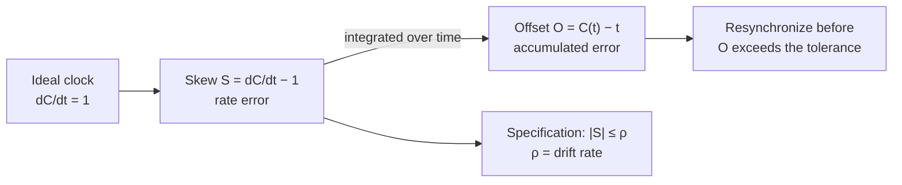

# Clock Correctness

*Korrektheit der Uhrzeit.* Before clocks can be synchronized, "a correct clock" has to be
defined.

**Every computer possesses a clock, which at time `t` displays the clock time `C(t)`.**

## Principles of clock correction

The summary lists two requirements on any correction procedure:

1. **jumps of clock times must not occur**
2. **monotonicity** (*Monotonie*): **for all `t₁ > t₂` it holds that `C(t₁) ≥ C(t₂)`**

> [!warning]
> The summary numbers these **1) and 3)** — the numbering skips 2, so a principle is
> missing from the source. The two that are present are reproduced above.

> [!inference]
> These two rules are what makes clock correction non-trivial. A clock that is 4 seconds
> fast **cannot simply be set back** — that would violate both rules and could make a file
> appear to be modified before it was created. The fix is to slow the clock down until it
> has lost the 4 seconds, which is why corrections are expressed as rate adjustments rather
> than assignments. Note that [[algorithms/berkeley-algorithm|Berkeley]] hands out a
> *correction value* `D_i`, not a *new time*, for exactly this reason.

## The quantities

**Clocks often have different speeds.**

| Quantity | Definition | Meaning |
|---|---|---|
| **Ideal clock** | `C(t) = t`, i.e. `dC/dt = 1` | runs exactly at the rate of real time |
| **Skew** (*Skew*) | `S = dC/dt − 1` | the **rate error** — how much too fast or too slow |
| **Offset** | `O = C(t) − t` | the **accumulated error** at an instant |
| **Drift rate** (*Driftrate*) `ρ` | a constant with `\|S\| ≤ ρ` at all times | the **specified bound on the rate error** |

> [!definition]
> **A clock works within its specification if there is a constant `ρ` (the drift rate) such
> that at all times `|S| ≤ ρ`.**

> [!inference]
> Skew and offset are **derivative and integral of each other**, and that relation is the
> whole engineering content of clock synchronization. A bounded skew `ρ` does **not** bound
> the offset — it only bounds how fast the offset grows. So the offset is guaranteed to
> exceed any tolerance eventually, and the only question is *how often you must
> resynchronize*. That is why [[concepts/clock-synchronization]] states its goal as
> *"synchronize before the maximum tolerable deviation is exceeded"*, and it is exactly
> what exercise 5.1 d) computes.

> [!exam]
> If two clocks each have drift rate `ρ`, they drift apart at up to `2ρ`, so to keep them
> within `D` of each other they must be resynchronized at least every `D / 2ρ`. The
> summary does not state this formula, but it is the standard follow-up to the definitions
> above and it mirrors the `2D` result in [[concepts/clock-synchronization]].

## Related
- [[concepts/clock-synchronization]]
- [[concepts/synchronization]]
- [[algorithms/cristians-algorithm]]
- [[algorithms/berkeley-algorithm]]
- [[exercises/ex05-storage-and-clock-synchronization]]
- [[chapters/05-distributed-resources-and-synchronization]]
