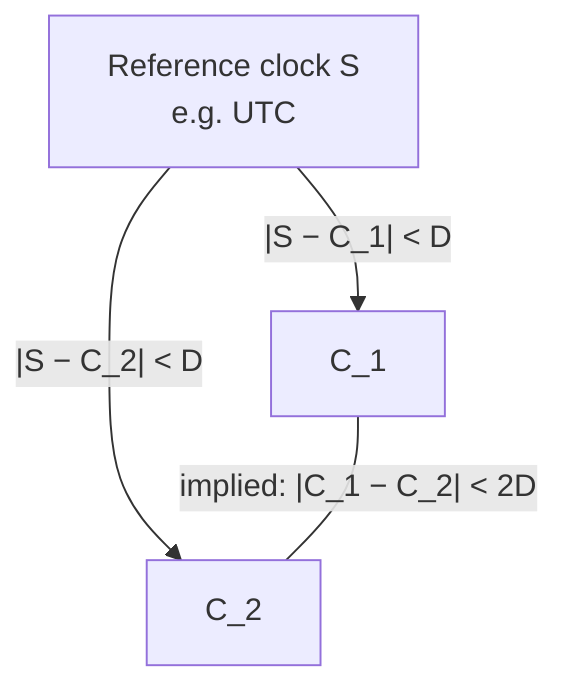

# Clock Synchronization

*Uhrensynchronisation.* Two precise definitions, and one theorem connecting them.

## The two definitions

> [!definition]
> **External synchronization.** The clocks of the computers `R_i` are **synchronized
> externally with accuracy `D` with the clock of computer `S` in the interval `I`** if
>
> ```text
> |S(t) − C_i(t)| < D
> ```
>
> **for all computers `R_i` and all times `t` in `I`.**

> [!definition]
> **Internal synchronization.** The clocks are **synchronized internally with accuracy `D`
> in the interval `I`** if
>
> ```text
> |C_i(t) − C_j(t)| < D
> ```
>
> **for all computers `R_i`, `R_j` and all times `t` in `I`.**

In operational terms:

- **external synchronization: all computers synchronize themselves regularly with a
  server**
- **internal synchronization: all computers synchronize themselves regularly with one
  another; there is no central server**

> [!definition]
> **Goal: synchronize before the maximum tolerable deviation is exceeded.**

## The relationship between them

> [!theorem]
> **If the clocks of computers are synchronized externally with accuracy `D` with the clock
> of a computer `S` in the interval `I`, then they are synchronized internally with
> accuracy `2D`.**

> [!proof]
> By the triangle inequality. For any two computers `R_i`, `R_j` and any `t ∈ I`:
>
> ```text
> |C_i(t) − C_j(t)| = |(C_i(t) − S(t)) + (S(t) − C_j(t))|
>                   ≤ |C_i(t) − S(t)| + |S(t) − C_j(t)|
>                   <  D + D  =  2D
> ```



> [!inference]
> The theorem has **no converse**, and that asymmetry is the single most important fact in
> this section. External synchronization buys internal synchronization for free at twice
> the error; internal synchronization buys **nothing** about real time. A perfectly
> internally synchronized system can agree unanimously on a completely wrong time — which
> is precisely what exercise 5.3 (2) demonstrates, where
> [[algorithms/berkeley-algorithm|Berkeley]] drags the one correct clock in the group 3
> seconds away from the truth.

> [!inference]
> This is why the two algorithm families split the way they do:
> [[algorithms/cristians-algorithm|Cristian]] and
> [[concepts/network-time-protocol|NTP]] are external (there is a UTC source), while
> [[algorithms/berkeley-algorithm|Berkeley]] is internal (there is only a coordinator). If
> you need real time, internal synchronization is not a cheaper substitute — it is a
> different guarantee.

> [!exam]
> Be able to state both inequalities with the quantifiers intact (*for all computers and
> all times in `I`*) and to prove the `2D` theorem in one line with the triangle
> inequality.

## Related
- [[concepts/clock-correctness]]
- [[algorithms/cristians-algorithm]]
- [[algorithms/berkeley-algorithm]]
- [[concepts/network-time-protocol]]
- [[concepts/synchronization]]
- [[exercises/ex05-storage-and-clock-synchronization]]
- [[chapters/05-distributed-resources-and-synchronization]]
