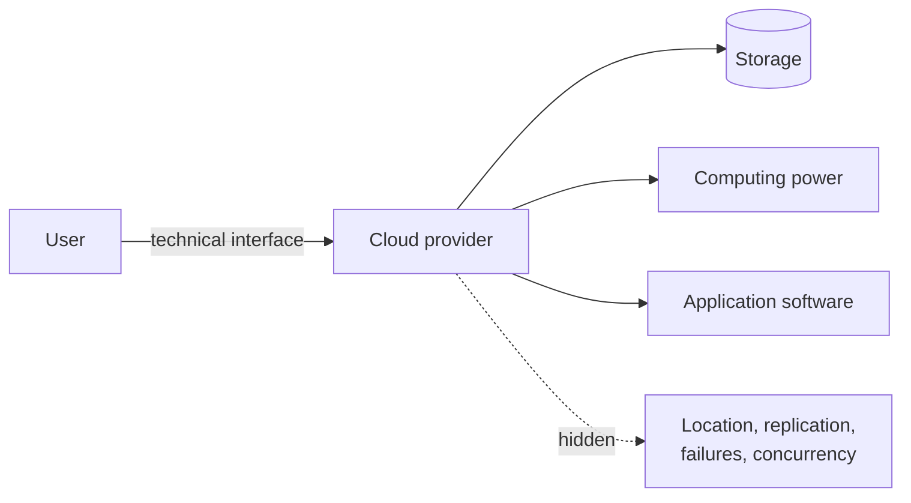

# Cloud Computing

Cloud computing packages IT resources as a service delivered over the internet, with the goal
of unlimited horizontal scaling.

> [!definition]
> In **cloud computing**, IT resources such as **storage space, computing power or application
> software** are **provided as a service over the internet**. The goal is **unlimited
> horizontal scaling with high [[concepts/elasticity|elasticity]]**.

## Properties

- Offers a **high degree of [[concepts/transparency]]** — the user does not see where or on
  how many machines the work happens.
- **Usage through technical interfaces** (APIs).

*The cloud is the industrial realization of transparency plus elastic horizontal scaling.*

> [!inference]
> The module frames cloud computing as the end point of Chapter 2's argument rather than as a
> topic in its own right: it is where [[concepts/scalability]],
> [[concepts/elasticity]] and [[concepts/transparency]] all come together.

## Related
- [[concepts/elasticity]]
- [[concepts/scalability]]
- [[concepts/transparency]]
- [[concepts/cloud-service-models]]
- [[concepts/virtualization]]
- [[chapters/02-foundations-of-distributed-systems]]
