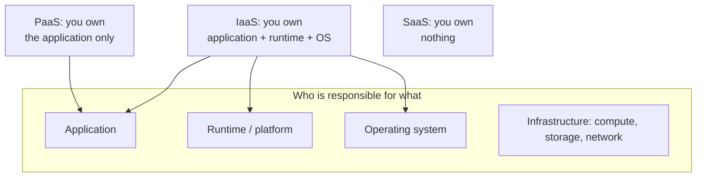

# Cloud Service Models — IaaS, PaaS, SaaS

The chapter restates the [[concepts/cloud-computing|cloud-computing]] definition and then
splits it into three service models.

> [!definition]
> **Cloud computing** is understood to mean the **massive bundling of computing resources
> at a central location by a provider. The resources can be used by users over a network.**

## Infrastructure as a Service (IaaS)

> [!definition]
> **IaaS provides IT resources such as storage, computing power or network capacities.
> Users have control over the operating system and the applications. They are responsible
> for operating the software themselves.**

- **computing instances can be arbitrarily enlarged or reduced as required**
- **the user has full access to the instances, but is responsible for the OS level
  himself**

## Platform as a Service (PaaS)

> [!definition]
> **PaaS provides programming models and development tools in order to create and execute
> applications. Providers make the required resources — computing power, storage, network,
> load balancing and databases — available automatically at deployment of the application.
> These scale depending on the requirements.**

- **the cloud takes over the distribution onto the actual processing units**
- **the user has no direct access to the computing instances; he gets no virtual servers**

## Software as a Service (SaaS)

> [!definition]
> **With SaaS the provider makes applications available for users. Users have to worry
> neither about the technical infrastructure nor about installation/updates. These happen
> centrally through the provider, so that the current version of the software is always
> available.**

- **the cloud is completely transparent for the user**
- **access to the software is usually via a web browser**
- **the service provider takes over the complete IT administration and further services**

## The three models side by side

| | IaaS | PaaS | SaaS |
|---|---|---|---|
| What you rent | storage, computing power, network | a programming model + runtime | a finished application |
| You control | OS and applications | your application only | nothing |
| You operate | the software yourself | nothing below your code | nothing |
| Virtual servers visible? | **yes, full access** | **no** | **no** |
| Scaling | you resize instances | **automatic, on deployment** | the provider's problem |
| Access | instances | deployment pipeline | **web browser** |

> [!inference]
> The three models form a **single axis — how far up the stack the provider's
> responsibility reaches** — and [[concepts/transparency|transparency]] increases along
> exactly that axis, which is why the summary can say *"the cloud is completely transparent
> for the user"* only at the SaaS end. Transparency and control are the same quantity
> measured from opposite ends. Chapter 2 made the same point about
> [[concepts/distribution-server|distribution servers]]: you buy transparency by giving up
> the ability to intervene.

## Cloud computing, weighed

| Advantages | Prerequisites |
|---|---|
| **accessible from anywhere** | **broadband everywhere** |
| **no data backup** needed by the user | **network availability** |
| **no software maintenance** needed by the user | |

> [!warning]
> The two prerequisites are also the two failure modes. Every advantage in the left column
> is conditional on the network being there — and chapter 2 established that
> [[concepts/distributed-system|network failures are independent and partial]]. The cloud
> converts a local-hardware risk into a connectivity risk; it does not remove the risk.

> [!exam]
> The cleanest discriminator is the **virtual server** question: with IaaS you see and
> control virtual servers, with PaaS you explicitly do not get any, with SaaS the question
> does not arise. The summary states this for IaaS and PaaS in so many words.

## Related
- [[concepts/cloud-computing]]
- [[concepts/virtualization]]
- [[concepts/containers]]
- [[concepts/storage-architectures]]
- [[concepts/elasticity]]
- [[concepts/transparency]]
- [[chapters/05-distributed-resources-and-synchronization]]
