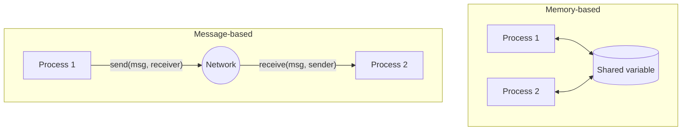

# Communication Paradigms — Memory-based vs. Message-based

Two processes can coordinate in exactly two ways: through a shared address space, or by
sending each other messages. Only the second works in a [[concepts/distributed-system]].

> [!definition]
> **Memory-based communication** (*speicherbasierte Kommunikation*): processes have access to
> a shared memory region (*shared memory*). Communication happens by **reading from and
> writing to shared variables** in that region.

> [!definition]
> **Message-based communication** (*nachrichtenbasierte Kommunikation*): the communicating
> processes **send each other messages over a network**.


*A distributed system is by definition restricted to the right-hand paradigm.*

## Message-based communication in detail

- A **message** is a **byte sequence**.
- Operations:

```text
send(message, receiver)
receive(message, sender)
```

### Prerequisites

1. A **physical medium** between the communication partners.
2. A **communication protocol**, i.e. rules of behaviour (*Verhaltensregeln*) covering:
   - coding rules (*Kodierungsregeln*)
   - message length and format
   - form of addressing
   - acknowledgements and error codes
3. A **common language and common semantics** — both sides must agree on what the bytes mean.

> [!exam]
> This is exactly the distinction behind "distributed system vs. multiprocessor system":
> multiprocessor systems use memory-based communication, distributed systems may not.
> See [[concepts/distributed-system]].

## Worked examples
- [[exercises/ex02-foundations-and-2pc]] (task 2.1/3)

## Related
- [[concepts/distributed-system]]
- [[concepts/blocking-function]]
- [[concepts/synchronous-communication]]
- [[concepts/asynchronous-communication]]
- [[concepts/application-protocol]]
- [[chapters/02-foundations-of-distributed-systems]]
