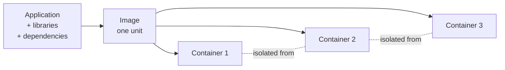
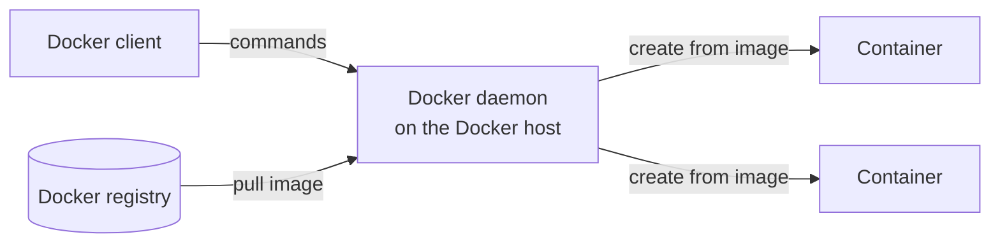

# Containers and Managed Applications

> [!definition]
> A **managed application** is an **application that is installed and executed in a
> controlled environment by the user. For this, the application together with the libraries
> it uses and further dependencies is stored in one unit (an *image*).**

- **the app is separated from the infrastructure**
- **the image is transferred into a container**
- **containers are comparable with virtual machines**
- **containers are executed strictly isolated from one another**

> [!inference]
> The defining move is **bundling the dependencies with the application**, not the
> isolation. Isolation is what a [[concepts/virtualization|virtual machine]] already gave
> you. What the image adds is that *"it ran on my machine"* stops being a property of the
> machine — the environment travels with the code. This is the same instinct as
> [[concepts/external-data-representation|marshalling]]: if the two ends cannot be assumed
> to agree, ship the description along with the data.

## Docker

The summary's example: **Docker executes managed applications in containers.** A **Docker
container is in principle a process.**

| Component | Role |
|---|---|
| **Docker host** | **provides the environment in which containers run** |
| **Docker client** | **communication of the user with the daemon** |
| **Docker container** | **an isolated, secure application platform.** Containers are **started, stopped, moved and deleted.** **Each container is formed from the Docker image and contains everything a runnable app needs.** |
| **Docker image** | the **template from which a container is created** |
| **Docker registry** | **Docker images are held in a registry and can be loaded from there into containers** |

> [!inference]
> *"A Docker container is in principle a process"* is the sentence that explains every
> practical difference from a VM: process start-up times, process-level memory accounting,
> process-level isolation guarantees. It also explains the unstated cost — a process shares
> the host kernel, so container isolation is **weaker** than VM isolation, which the
> summary's word *"strictly"* rather glosses over.

> [!inference]
> The registry is the third naming service in this wiki, after the
> [[concepts/rmi-registry|RMI registry]] and the
> [[models/nfs|NFS mount service]]: a well-known place that maps a name to a thing you then
> load and instantiate. Worth noticing as a pattern rather than three unrelated facts.

> [!exam]
> Containers were already named once, in
> [[concepts/libraries-frameworks-and-containers]] (chapter 3), in the sense of a
> *component container* that calls your code. That is a **different meaning** of the same
> word. Here a container is a **packaged, isolated execution environment**. Do not conflate
> them.

## Related
- [[concepts/virtualization]]
- [[concepts/libraries-frameworks-and-containers]]
- [[concepts/cloud-service-models]]
- [[concepts/cloud-computing]]
- [[concepts/rmi-registry]]
- [[chapters/05-distributed-resources-and-synchronization]]
