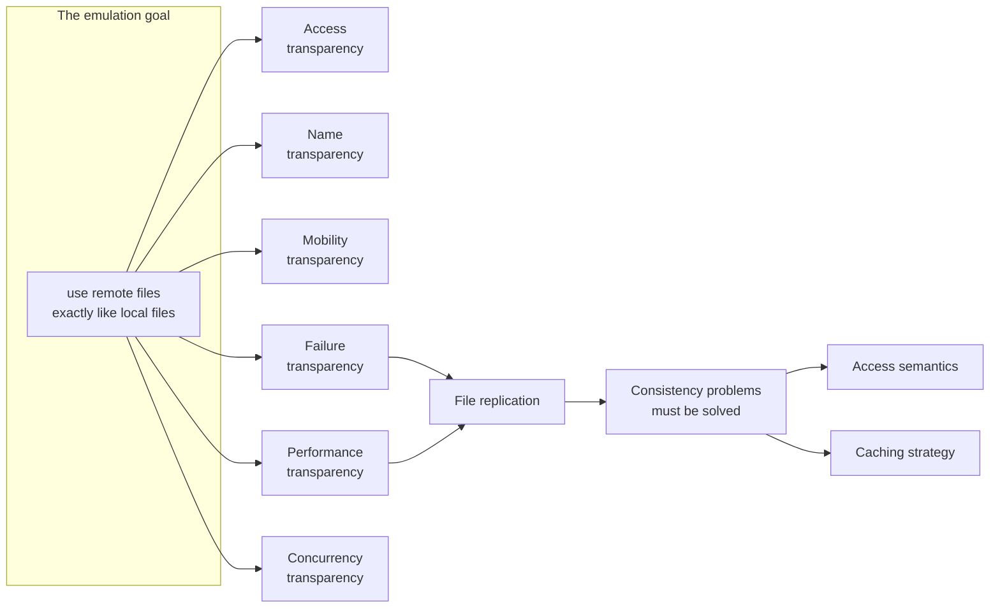

# Distributed File System

> [!definition]
> A **distributed file system** (*verteiltes Dateisystem*) **supports the shared use of
> files in a network. It emulates the functionality of a non-distributed file system and
> makes it possible to use remote files exactly like files in the local file system.**

> [!inference]
> Note the wording: *emulates* and *exactly like*. This is the same design goal that
> [[concepts/remote-invocation]] stated for procedure calls — "the call should not differ
> from a local call" — applied to storage instead of control flow. And it runs into the
> same wall: chapter 4 concluded that **not all aspects can be made transparent**, and the
> requirement catalogue below is really a list of the places where the emulation leaks.

## Requirement catalogue

The summary lists these as *Anforderungen an verteilte Dateisysteme*. Six of the eight are
[[concepts/transparency|transparency]] requirements.

| Requirement | What it demands |
|---|---|
| **Access transparency** (*Zugriffstransparenz*) | the same access operations as for local files — i.e. **the distribution stays hidden from clients** |
| **Name transparency** (*Namenstransparenz*) | a **uniform namespace** |
| **Mobility transparency** (*Mobilitätstransparenz*) | **moving a file** must stay transparent to client programs |
| **Performance transparency** (*Leistungstransparenz*) | the **same performance within a load range** |
| **Failure transparency** (*Fehlertransparenz*) | after a client or server fails, **operation continues conventionally** |
| **Concurrency transparency** (*Nebenläufigkeitstransparenz*) | simultaneous actions on one file by different clients **do not disturb each other** — i.e. concurrency control |
| **File replication** (*Dateireplikation*) | data services may create **replicas**; the resulting consistency problems must be solved. Benefits: **fault tolerance** and **relief of the main memory / load** |
| **Heterogeneity** (*Heterogenität*) | **heterogeneous clients must be supported** |
| **Security** (*Sicherheit*) | named in the summary without further elaboration |

> [!inference]
> Performance transparency is the quiet contradiction in the list. A remote file **cannot**
> perform like a local one — the network latency is real and
> [[concepts/file-caching-and-replication|caching]] is the only lever. Note how the summary
> hedges it: *the same performance* **within a load range** (*innerhalb eines
> Lastbereiches*). That is not transparency, it is a service-level promise. Compare the
> honest version in [[concepts/remote-invocation]].

> [!exam]
> Replication appears here as a **requirement** but was introduced in
> [[concepts/replication]] as a **mechanism** with a cost (`r > k·w`). Both framings are in
> the course. If asked "why replicate files", give the two reasons the summary gives —
> fault tolerance and load relief — and then name the price: consistency.

## Related
- [[concepts/file-system]]
- [[concepts/file-access-semantics]]
- [[concepts/file-caching-and-replication]]
- [[concepts/stateless-and-stateful-servers]]
- [[concepts/transparency]]
- [[concepts/replication]]
- [[models/nfs]]
- [[chapters/05-distributed-resources-and-synchronization]]
