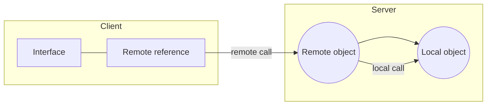
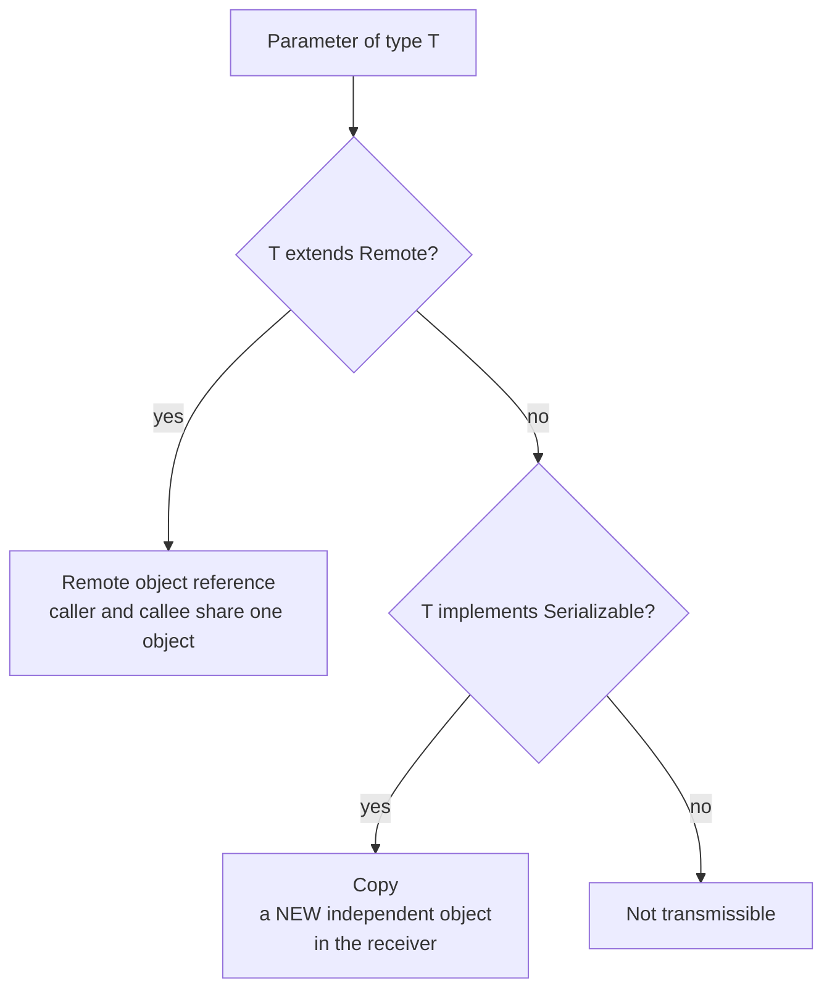

# The Distributed Object Model

## What object orientation adds

The **basic principle of RPC is identical for object-oriented languages**, however
**extensions are necessary**:

- a **method is executed in the context of objects**,
- **objects as parameters**,
- **inheritance**,
- **polymorphism**.

> [!theorem]
> **To call a method of a remote object, a reference to that object must exist.**

This single requirement is what forces the existence of remote references and therefore of
the [[concepts/rmi-registry|registry]] — a client that has no reference to anything can
never begin.

## Non-distributed vs. distributed object model

| Non-distributed object model | Distributed object model |
|---|---|
| Object references | **Remote method calls** — calling object and receiving object on **different** computers |
| Method calls can change the object state | **Local method calls** — calling object and receiving object on **one** computer |
| Classes | **Interfaces** |
| Exceptions | Objects in another process/computer are called **remote objects** |
| Garbage collection | **Remote references (proxies)** |


*A remote reference on the client; local calls continue to exist on the server.*

> [!inference]
> The right-hand column replaces *classes* with *interfaces* because a class carries an
> implementation, and the implementation cannot be shipped — only its signature can. Every
> row of the table is an instance of the same move: anything that assumed shared memory is
> replaced by something that can be expressed as a message or a name.

## Local object vs. remote object (Java)

| | **Local object** | **Remote object** |
|---|---|---|
| **Object definition** | Java class | remotely callable methods are defined in an **interface which extends `Remote`** |
| **Object implementation** | Java class | Java class which **implements the remote interface** |
| **Object creation** | constructor of the class | the constructor **is executed on the server**; **clients cannot call these constructors directly** |
| **Object access** | via a local reference to the object | via a **local reference to a proxy** of the remote object |
| **Exception** | `Exception` | **`RemoteException`** |

## Parameter passing rules

1. **Primitive values and objects whose class implements `Serializable` can be used as
   parameters or return values; transmission as values.**
   - **If such an object is passed as a value, a new object is created in the receiver's
     process.**
   - **This object is independent of the original object** — i.e. **changes to one of the
     objects have no influence on the state of the other.**
2. **If the type of a parameter or return value is a remote interface, then it is passed as
   a remote object reference.**

```text
decide_parameter_passing(T):
    if T is a remote interface          -> pass a REMOTE REFERENCE   (shared object)
    else if T implements Serializable   -> pass BY VALUE (deep copy) (independent object)
    else                                -> error: not transmissible
```



> [!exam]
> Exercise 4.2 asks exactly this: class `A` implements `Serializable` but **not** `Remote`,
> and a remote method returns `A`. **The client gets a new object in its own process, which
> is independent of the original** — later changes on the server are invisible to it. The
> single word that decides value-vs-reference is `Remote`.

> [!inference]
> This is [[concepts/stubs-and-skeletons|call-by-copy]] again, now chosen per *type* rather
> than per *call*. The language-level decision replaces the IDL's explicit `in`/`out`
> markers.

## Related
- [[models/java-rmi]]
- [[concepts/rmi-registry]]
- [[concepts/remote-invocation]]
- [[concepts/stubs-and-skeletons]]
- [[concepts/proxy]]
- [[exercises/ex04-rpc-rmi-and-ber]]
- [[chapters/04-remote-invocation]]
