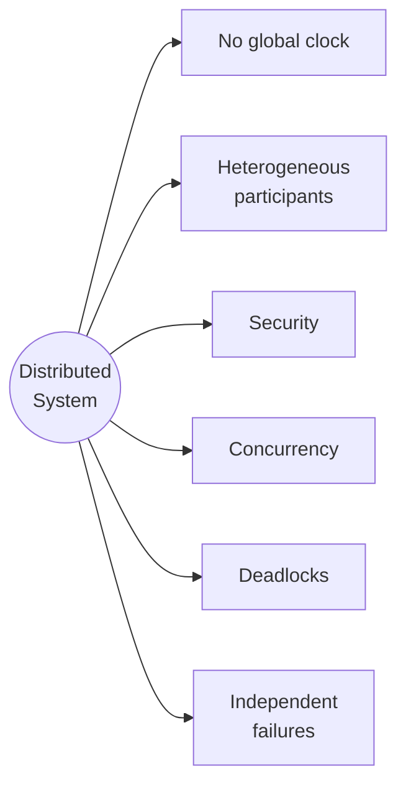

# Distributed System

A distributed system (*Verteiltes System*) is a collection of software components running on
networked computers that coordinate their actions exclusively by exchanging messages, while
presenting themselves to the user as one coherent system.

> [!definition]
> A system is called a **distributed system** if
> 1. its software components reside on **networked computers**,
> 2. the components communicate **only by exchanging messages**, and
> 3. it appears to the user as a **single coherent system**.

All three conditions must hold. Condition (2) is what rules out shared-memory multiprocessors;
condition (3) is what demands [[concepts/transparency]].

## Motivation

- **Resource sharing** (*gemeinsame Ressourcennutzung*)
  - physical resources: hard disks, CPUs
  - logical resources: data
- **Information exchange** between participants
- **Geographically distributed access** to applications
- **Virtualization** of IT systems
- **Economy** (*Wirtschaftlichkeit*) — many cheap machines instead of one large one
- **Reliability** (*Verlässlichkeit*) — redundancy survives individual failures
- **The real world is itself a distributed system**

## Drawbacks

- New **security risks** — every message on the network is exposed
- **Increased complexity** — protocols, partial failures, concurrency
- **Performance losses** — network latency dominates local computation

## Inherent problems

*The six structural problems named in the module.*

Each motivates later machinery: no global clock → logical clocks; independent failures →
commit protocols such as [[algorithms/two-phase-commit]]; heterogeneity → middleware and a
common wire format ([[concepts/byte-order]]).

## Distributed system vs. multiprocessor system

| Distributed system | Multiprocessor system |
|---|---|
| No shared memory; remote syscalls | Shared memory, tight coupling |
| Communication via messages — a **protocol is required** | Direct communication through memory |
| Heterogeneous — **middleware needed** | Homogeneous system |
| **No global clock** — synchronization required | Global clock |
| Synchronization across components can cause deadlocks | Local synchronization primitives |
| Concurrency hard to control | Concurrency comparatively easy to control |

> [!exam]
> Examiners ask for the three-part definition verbatim. State all three bullets, then name
> at least two consequences (no global clock, independent failures).

## Worked examples
- [[exercises/ex02-foundations-and-2pc]] (tasks 2.1/1 and 2.1/2)

## Related
- [[concepts/transparency]]
- [[concepts/scalability]]
- [[concepts/communication-paradigms]]
- [[concepts/clock-synchronization]]
- [[chapters/01-networking-and-sockets]]
- [[chapters/02-foundations-of-distributed-systems]]
