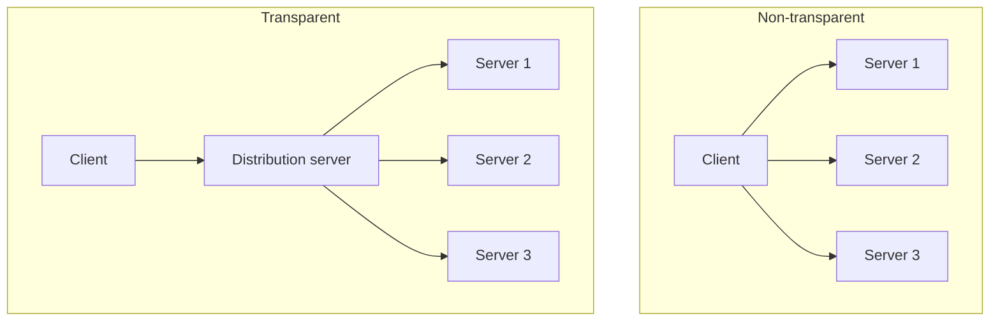

# Distribution Server (Load Balancer)

## Service provision by several servers

Services are **realized multiple times on separate computers**.

**Advantages:** increased availability, load distribution, failure safety.

Two ways to use the extra servers:

| | **Distribute** (split) the data | **Replicate** (copy) the data |
|---|---|---|
| Each server holds | a different part | the same data |
| Key problem | finding the right server | consistency on writes |

**Combination:** **distribute static objects, replicate dynamic objects.**

## Transparent vs. non-transparent

| | Non-transparent | Transparent |
|---|---|---|
| Client must know | the addresses of **all** servers | **a single** address |
| Adding/removing a server | high effort | easy |
| Realized by | — | a **distribution server** (*Verteilserver*) |



See [[concepts/transparency]] — this is location and migration transparency in practice.

## The distribution server

- **Only forwards requests.**
- The **client need not know the data partitioning**.
- **Can implement a cache.**

### Load distribution strategies

```text
on request(r):
    s ← select_server(r)
    forward r to s
    return answer of s to the client

select_server strategies:
    random         : pick any server uniformly at random
    round_robin    : i ← (i + 1) mod n ; return servers[i]
    load_dependent : return argmin over s of load(s)
    nearest        : return argmin over s of latency(client, s)
```

### Problems

> [!warning]
> - **Single point of failure** — the whole service dies with the distribution server.
> - **Overload of the distribution server** — every request passes through it.

> [!inference]
> The distribution server buys transparency and load distribution at the cost of
> reintroducing a central bottleneck — the very thing
> [[models/centralized-and-decentralized-architectures|decentralized architectures]] avoid.
> That trade is the whole point of the section.

## Distributed data vs. replicated data

**Distributed data, non-transparent partitioning:** several servers offer the service, each
server manages its own data; the partitioning is not transparent, so clients must know which
server holds which data and must know the corresponding address.

**Distributed data, transparent partitioning:** access via a distribution server; externally
the servers appear as a single server; the addresses of the servers holding the data stay
hidden.

**Replicated data:** several servers offer the service, each managing the *same* data.
Realized **with or without** a distribution server. The **difference from distributed data is
the preservation of consistency on writing accesses** — see [[concepts/replication]].

> [!contradiction]
> One summary table (p. 13) labels **distributed data = transparent** and **replicated data
> = not transparent**, but the following page (p. 14) explicitly presents *both* a
> transparent and a non-transparent variant of distributed data, and says replication works
> **with or without** a distribution server.
>
> **Resolution:** transparency is *not* a property of distribute-vs-replicate at all. It is a
> separate, orthogonal choice — whether a distribution server fronts the servers. The p. 13
> table is best read as a note about the two *examples* drawn next to it, not as a general
> rule. Treat the p. 14 statement as authoritative.

### Example: the WWW

The application is **replicated to many web servers**, or the **data are split**; a
**front-end server performs the distribution**.

## Related
- [[concepts/replication]]
- [[concepts/proxy]]
- [[concepts/transparency]]
- [[concepts/scalability]]
- [[models/centralized-and-decentralized-architectures]]
- [[chapters/03-architectures-and-web-systems]]
