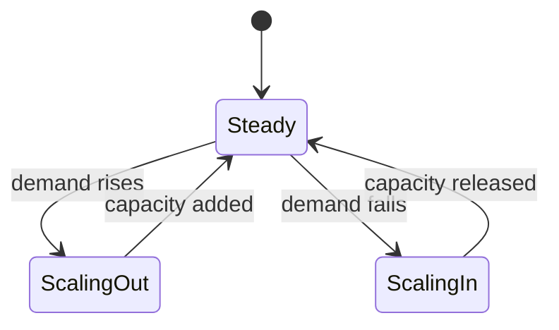

# Elasticity

Elasticity is scalability performed automatically and at runtime, in both directions.

> [!definition]
> **Elasticity** (*Elastizität*) describes the ability of a system to adapt **dynamically —
> that is, at runtime** — to **growing and shrinking** demand.

## Elasticity vs. scalability

| | [[concepts/scalability]] | Elasticity |
|---|---|---|
| Question answered | *can* the system adapt? | does it adapt **by itself, at runtime**? |
| Timing | design / deployment time | runtime |
| Direction | growth | growth **and** shrinkage |

*An elastic system continuously tracks demand in both directions.*

> [!inference]
> Elasticity presupposes **horizontal** scaling: you cannot add or remove RAM from a running
> machine on demand, but you can start and stop nodes. This is why the summary introduces
> elasticity immediately before [[concepts/cloud-computing]].

## Related
- [[concepts/scalability]]
- [[concepts/speedup]]
- [[concepts/cloud-computing]]
- [[concepts/virtualization]]
- [[chapters/02-foundations-of-distributed-systems]]
