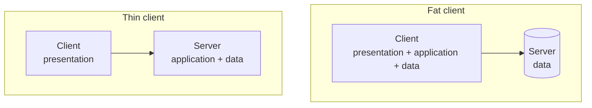

# Fat and Thin Clients

Where does the application logic run?

| | **Fat client** | **Thin client** |
|---|---|---|
| Client holds | presentation, application logic, data | presentation only |
| Server holds | data | application logic, data |

> [!inference]
> This is the same axis as two-tier vs. three-tier in
> [[models/architectural-styles]]: a fat client *is* the two-tier arrangement, a thin client
> *is* the three-tier one. The trade-offs follow mechanically:
>
> - **Fat client:** less server load, works better offline, but deployment and updates must
>   reach every client, and the client can be tampered with.
> - **Thin client:** central deployment and one place to fix bugs, but every interaction
>   costs a round trip, so [[concepts/performance-criteria|response time]] and server load
>   suffer.

The web browser is the canonical thin client, which is why
[[concepts/sessions-and-statelessness]] matters so much for web applications — the state has
nowhere obvious to live.

## Related
- [[models/architectural-styles]]
- [[concepts/libraries-frameworks-and-containers]]
- [[concepts/sessions-and-statelessness]]
- [[models/client-server-architecture]]
- [[chapters/03-architectures-and-web-systems]]
