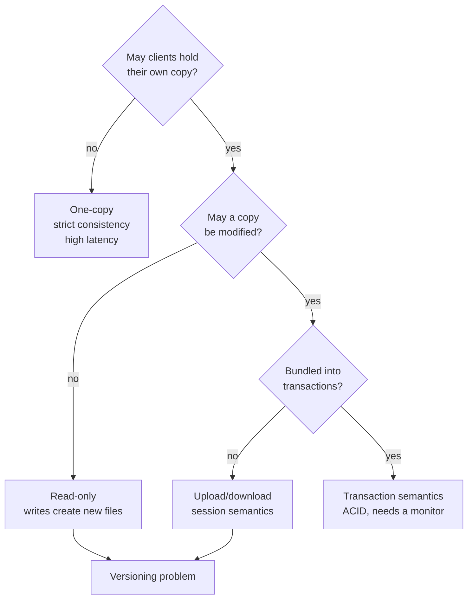

# File Access Semantics

*Semantik verteilter Dateizugriffe* — what a client is guaranteed to see when several
clients use the same file. This is the storage counterpart of
[[concepts/call-semantics|call semantics]]: a catalogue of guarantees, ordered by how much
they cost.

## The four models

### 1. One-copy semantics (Unix)

- **all changes become visible immediately**
- **no copies of the file exist**
- possibly **very large latencies**
- corresponds to **strict consistency**

### 2. Upload/download model

Also called **session semantics** (*Sitzungs-Semantik*).

- the client **registers the file access and receives a copy**
- **modifications to the file become visible only after `close`**
- **server-initiated validation**: the server **informs the client if the file has
  changed**

> [!warning]
> **Versioning problem** (*Versionsproblem*) **if several clients change the file
> simultaneously.** The summary's suggested answer: **merge**.

### 3. Read-only semantics

- idea: the file is **written once and then stays immutable** (*unveränderlich*)
- **write accesses by clients happen elsewhere and create new files**
- **makes replication easier — but the versioning problem is back again**

### 4. Transaction semantics

- **accesses to a file are bundled into transactions**
- a **transaction monitor guarantees the ACID properties**
- **requires administrative overhead** (*Verwaltungsaufwand*)

## Comparison

| Model | Copies? | When do changes become visible | Cost |
|---|---|---|---|
| One-copy | none | immediately | latency on every access |
| Upload/download | one per session | at `close` | versioning conflicts |
| Read-only | many | never (new file instead) | versioning conflicts |
| Transaction | managed | at commit | administrative overhead |

> [!inference]
> Read the tree as a single trade: **latency is paid in exchange for consistency, and the
> currency is copies.** One-copy keeps zero copies and pays in latency; everything to the
> right of it buys latency back with copies and pays the difference in conflicts. Note that
> read-only semantics does not actually escape the versioning problem — the summary says so
> explicitly — it just moves it from the file system into the naming of the new files.

> [!inference]
> Transaction semantics is the only model that *solves* rather than *manages* the conflict,
> and it is the only one whose cost is listed as administrative rather than as a failure
> mode. That cost is [[algorithms/two-phase-commit]] — and chapter 2 already showed it
> blocks when the coordinator fails. Nothing here is free.

> [!exam]
> One-copy semantics "corresponds to strict consistency" and "no copies exist" are two
> statements of the same fact. If there is only one copy, every read trivially sees the
> last write.

## Related
- [[concepts/distributed-file-system]]
- [[concepts/file-caching-and-replication]]
- [[concepts/sessions-and-statelessness]]
- [[algorithms/two-phase-commit]]
- [[concepts/call-semantics]]
- [[chapters/05-distributed-resources-and-synchronization]]
