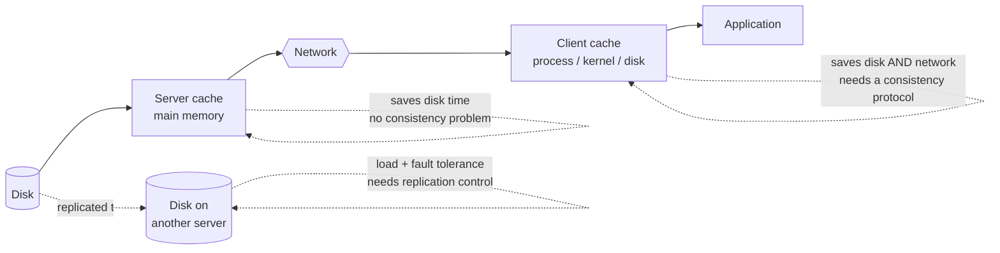

# File Caching and Replication

Three places a copy of file data can live, in increasing order of how much consistency
trouble they cause: **on the server**, **on several servers**, **on the client**.

## 1. Caching by the server

- **buffering only in the main memory of the server**
- **eliminates only disk transfer times**
- **from the client's point of view there is only a single copy**
- **the client always writes to the original file**
- **no consistency problems**
- **network latency is still present**

> [!inference]
> This is the free lunch of the three: a pure win with no consistency cost, because the
> cache is on the same side of the network as the authoritative copy. It is also the least
> valuable, because it removes the **smaller** of the two delays. Everything that removes
> the network delay costs consistency.

## 2. Replication of files

- **distribution of the load across several servers**
- **protection against data loss and server failures**

### Strict replication control (*strikte Replikationskontrolle*)

- **lock / unlock according to the data operation**
- **invalidate for copies that have become invalid**
- **update for immediate refresh**

### Weak replication control (*schwache Replikationskontrolle*)

- **write operations go to the primary copy**
- **delayed propagation of the change**

### Reconciliation procedure (*Abstimmungsverfahren*, voting)

- **between the servers, regarding different versions**

> [!inference]
> Strict control blocks a write until every copy agrees; weak control lets the copies
> disagree for a while and repairs them afterwards. Voting is what you need once you admit
> that the copies may be **concurrently** different — and "concurrently" is exactly the
> word [[concepts/causality]] makes precise in the second half of this chapter. This is the
> join between the two halves of chapter 5.

## 3. Client caching

- **eliminates disk accesses *and* message transport**
- **different consistency protocols are possible**
  - **central allocation of access rights at the server**
  - **different write-through strategies** (*Durchschreibstrategien*):
    - **immediate write-through to the server**
    - **delayed write-through to the server**
    - **write-back when the file is closed**
- **location of the buffer**:
  - **in the address space of the process**
  - **in the OS kernel**
  - **on the hard disk**

> [!inference]
> The three write-through strategies are the same three choices as in
> [[concepts/file-access-semantics]], seen from the implementation side: immediate
> write-through implements one-copy semantics, write-back at `close` implements session
> semantics. The access semantics is the *contract*; the write-through strategy is the
> *mechanism that delivers it*. Expect to be asked to connect the two.

> [!exam]
> The distinguishing question for the three cache locations is **what each one eliminates**:
> server cache removes disk time only; client cache removes disk time **and** network time;
> replication removes neither but adds availability and spreads load.

## Related
- [[concepts/file-access-semantics]]
- [[concepts/distributed-file-system]]
- [[concepts/replication]]
- [[models/nfs]]
- [[concepts/causality]]
- [[chapters/05-distributed-resources-and-synchronization]]
