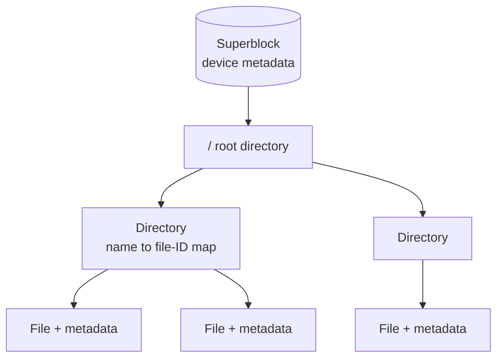

# File System

The non-distributed starting point. Everything in
[[concepts/distributed-file-system|the distributed case]] is an attempt to preserve these
properties across a network.

## The two properties a distributed system wants from storage

The summary opens the chapter by naming them:

| Property | Meaning |
|---|---|
| **Persistence** (*Persistenz*) | lasting, permanent storage — data outlives the process that wrote it |
| **Consistency** (*Konsistenz*) | parallel processes have **the same view of the data** |

> [!inference]
> These are exactly the two properties that make storage *hard* to distribute, and they
> pull in opposite directions. Persistence wants copies (so nothing is lost); consistency
> wants one authoritative value (so nothing disagrees). The rest of the chapter is the
> negotiation between the two — see [[concepts/file-caching-and-replication]].

## What a file system provides

- a **persistently stored set of data** (*persistent gespeicherte Datenmenge*)
- a **hierarchical namespace** (*hierarchischer Namensraum*)
- **directories** (*Verzeichnis*) — a directory is itself a file holding a **mapping of
  names to internal file IDs**
- **shared, simultaneous use with access control** (*gemeinsame, gleichzeitige Nutzung mit
  Zugriffskontrolle*) — via access methods and sequential access
- **metadata** (*Metadaten*)

### Metadata at three levels

| Level | Examples from the summary |
|---|---|
| File | size, etc. |
| Directory | contents, etc. |
| Device | superblock (*Superblock*) |

> [!inference]
> The detail that a directory is *"a file containing a mapping of names to internal file
> IDs"* is the one that matters later. It means the namespace is **data like any other
> data**, so it can be cached, replicated and made inconsistent exactly like file contents
> — and it means a whole subtree can be grafted in from elsewhere just by changing one
> mapping. That is precisely what [[models/nfs|mounting]] does.

## Related
- [[concepts/distributed-file-system]]
- [[concepts/persistent-data-storage]]
- [[concepts/storage-architectures]]
- [[models/nfs]]
- [[chapters/05-distributed-resources-and-synchronization]]
