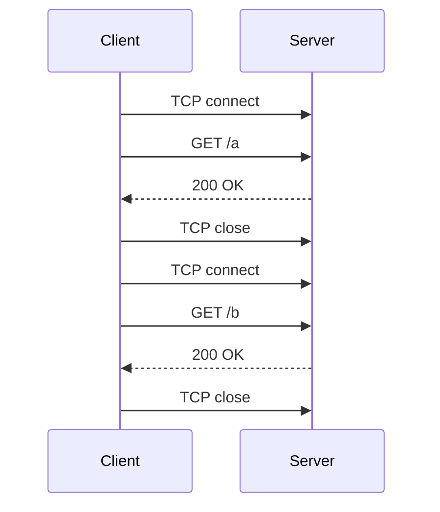
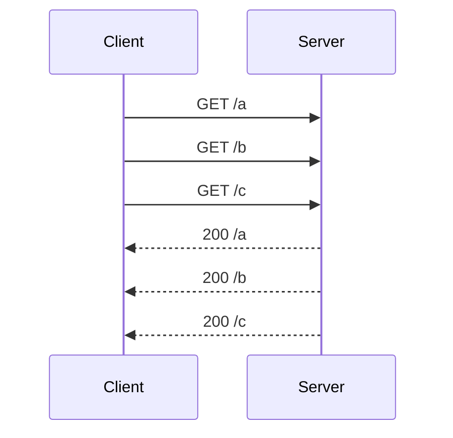
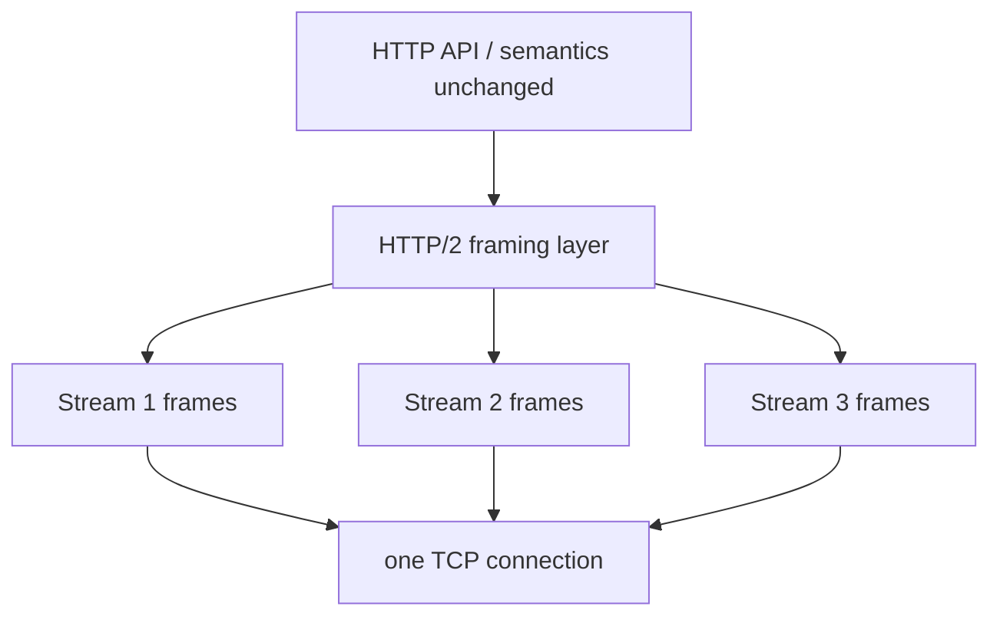

# Scalability of HTTP (HTTP/1.1 and HTTP/2)

## Disadvantages of HTTP/1.0.x

- **Headers are transmitted uncompressed.**
- **Headers of consecutive messages barely differ** — so almost all of that is redundant.
- **A new TCP connection is opened for every request.**
- The **number of open connections is limited by the operating system.**


*One connection per object — and a web page needs dozens.*

## Optimizations in HTTP/1.1

### 1. Persistent connections (`keep-alive` header)

Connections are **only closed after a timeout**.

> [!warning]
> **Problem:** the **first answer can delay the further answers** — **head-of-line
> blocking**.

### 2. Pipelining

**Several HTTP requests are handed to a single socket without waiting for the answer.** The
**server can process the requests in parallel**, and the **answers are sent in the same order
as the requests.**


*Requests overlap, but the ordering requirement keeps head-of-line blocking alive.*

> [!inference]
> Pipelining fixes the *request* side but not the *response* side: because answers must come
> back in request order, one slow response still stalls everything behind it. Only
> **out-of-order delivery** in HTTP/2 actually removes head-of-line blocking at the HTTP
> layer.

## HTTP/2

**Goal: optimization of the data transfer (bandwidth, latency).**

- **Combining several requests — multiplexing.**
- **Data compression possibilities — header compression.**
- **Binary-coded transfer.**
- **Out-of-order delivery.**
- **Server-initiated data transfers — push procedure.**
- **Tendency: all data transferred encrypted.**

### How it works

- A **new layer between TCP and the HTTP API.**
- **The semantics of HTTP are preserved — only the coding changes.**
- **Transparent splitting of HTTP messages into frames** and transfer in **streams**.
- **All communication between a client and a server runs over one TCP connection.**
- HTTP/2 **maps HTTP onto the exchange of binary-coded frames.**



> [!exam]
> "**The semantics of HTTP are preserved, only the coding changes**" is the sentence to
> remember — methods, status codes and headers are all identical; HTTP/2 is purely a
> transport-efficiency layer. That also makes it a textbook example of
> [[concepts/transparency]].

### Six procedures to increase the scalability of HTTP

```text
1. persistent connections      (HTTP/1.1)
2. pipelining                  (HTTP/1.1)
3. combining several requests  (multiplexing, HTTP/2)
4. data compression            (header compression, HTTP/2)
5. binary-coded transfer       (HTTP/2)
6. out-of-order delivery       (HTTP/2)
```

## Related
- [[concepts/http]]
- [[concepts/scalability]]
- [[concepts/performance-criteria]]
- [[concepts/tcp]]
- [[concepts/transparency]]
- [[exercises/ex03-architectures-and-http]]
- [[chapters/03-architectures-and-web-systems]]
