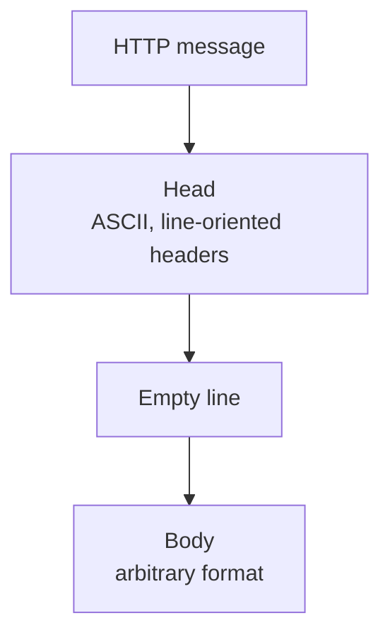
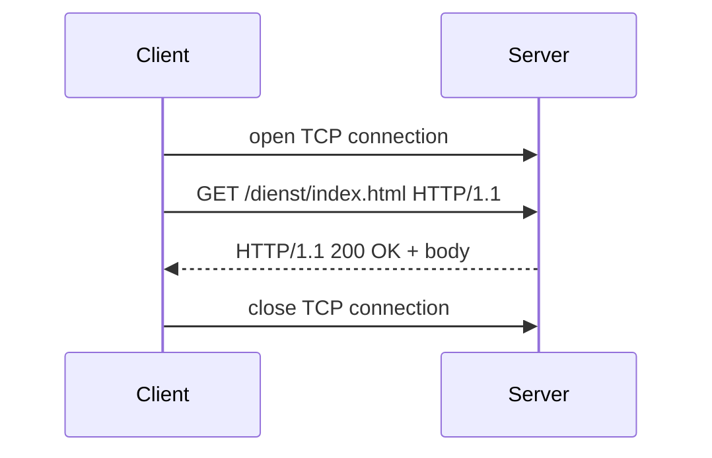

# HTTP: Hypertext Transfer Protocol

A **generic client–server protocol** for the **exchange of data in arbitrary formats**. It is
the module's worked example of an [[concepts/application-protocol]].

## Addressing

| Layer | What is addressed | How |
|---|---|---|
| **TCP** | an **application on a computer** | IP address of the server + port of the application |
| **HTTP** | a **document on a computer** | **URLs** |

### URL structure

```text
http://www.sale.de:80/dienst/shop?var1=alles&id=21
└─┬─┘  └────┬─────┘└┬┘└────┬────┘ └────────┬─────┘
scheme   server    port   path          parameters
```

- **server name with port** — `www.sale.de`
- **path specification** — e.g. `/dienst/shop`
- **parameters** — `var1=alles & id=21`

## Message format

- HTTP messages are split into **head** and **body**.
- The **HTTP head is ASCII-coded** and has **arbitrary length** — this is why HTTP is called
  a **text-based protocol**.
- **Head and body have the same structure for requests and answers.**
- **End of the head: the first empty line.**
- **Structure of the head:** line-oriented, **one name–value pair per line**; a single such
  line is called a **header**.
- **Structure of the body:** no specification, arbitrary format.
- The **header contains information about the size of the body** (`Content-Length`).



## Request semantics

The semantics of the request are **described by the first line in the head.**

| Command | Meaning | Changes server state? |
|---|---|---|
| **GET** | query information; read a resource | **no** |
| **PUT** | store resources; save data | yes |
| **POST** | store and **add** information; append data to a file | yes |
| **DELETE** | delete resources | yes |

### Sequence of a request

```text
1. The client opens a TCP connection to the server
2. The client sends the HTTP request to the server
3. The server sends the HTTP answer to the client
4. Client and server close the TCP connection
```



### Example

Request:
```http
GET /dienst/index.html HTTP/1.1
Cookie: name=value, ...

```

Answer:
```http
HTTP/1.1 200 OK
Content-Length: 1900
Set-Cookie: name=value, ...

<html>...</html>
```

## The answer

The server informs the client about the status of the request:

```text
HTTP/1.1 <status code> <status text>
```

| Class | Meaning |
|---|---|
| **1xx** | information |
| **2xx** | the request could be processed successfully |
| **3xx** | the resource is reachable under another URL |
| **4xx** | error caused on the **client** side |
| **5xx** | error caused on the **server** side |

Information about the **coding of the body** is in the header **`Content-Type`**, which
carries a **MIME type** — e.g. `image/jpeg`, `text/html`. **The client uses `Content-Type`
to display the data.**

## Parameters

HTML provides **forms** for entering parameters. The **names and the contents of the fields
are part of the request**; the **browser codes the entries into a single character string.**

```html
<form action="..." method="POST">
  <input name="username"/>
  <input name="email"/>
  <textarea name="text"></textarea>
  <input type="submit" value="send form data"/>
</form>
```

The data land **in the body of the request**:

```text
username=Stefan+M%FCller&email=stefan&text=test
```

with MIME type **`application/x-www-form-urlencoded`**. Note the two encoding rules visible
here: **space becomes `+`** and **every non-ASCII byte becomes `%HH`**.

> [!inference]
> Percent-encoding operates on **bytes, not characters**. The text is first encoded to bytes
> in some charset, and *then* each byte outside the safe ASCII set is written as `%HH`. The
> example makes this visible: `M%FCller` is `Müller` with `ü` as the single byte `0xFC`,
> i.e. **Latin-1**. Encoded as UTF-8 the same character is two bytes and would appear as
> `M%C3%BCller`. One character can therefore become several `%HH` groups, which is why the
> charset has to be agreed separately — the encoding itself does not record it.

## Web applications

- In the WWW, **hypertexts in HTML format** are usually requested.
- Documents are **often first generated on arrival of the request by an application**.
- **Applications are programs that generate HTML documents**, and the **programs are
  identified by URLs**.
- On a request to such a URL, the **server calls the program with the handed-over parameters
  and returns the generated document.**
- The **parameters are handed over as a coded string**, and the **program decodes them into
  suitable data types.**

To simplify the transfer of **structured** data, **data interchange formats** were developed
— see [[concepts/json]].

## Java client sketch

```java
URL url = new URL("http://example.com/index.html");
URLConnection urlCon = url.openConnection();
int statusCode = ((HttpURLConnection) urlCon).getResponseCode();
```

## Related
- [[concepts/application-protocol]]
- [[concepts/tcp]]
- [[concepts/http-scalability]]
- [[concepts/sessions-and-statelessness]]
- [[concepts/json]]
- [[concepts/service-oriented-architecture]]
- [[exercises/ex03-architectures-and-http]]
- [[concepts/remote-invocation]]
- [[chapters/03-architectures-and-web-systems]]
