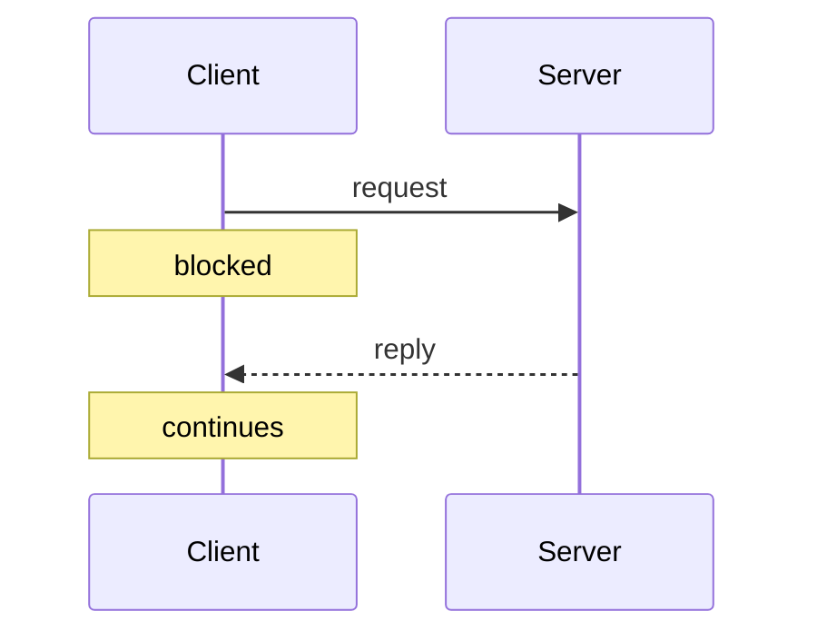
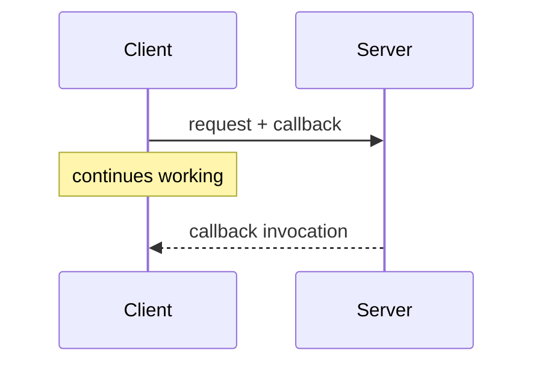
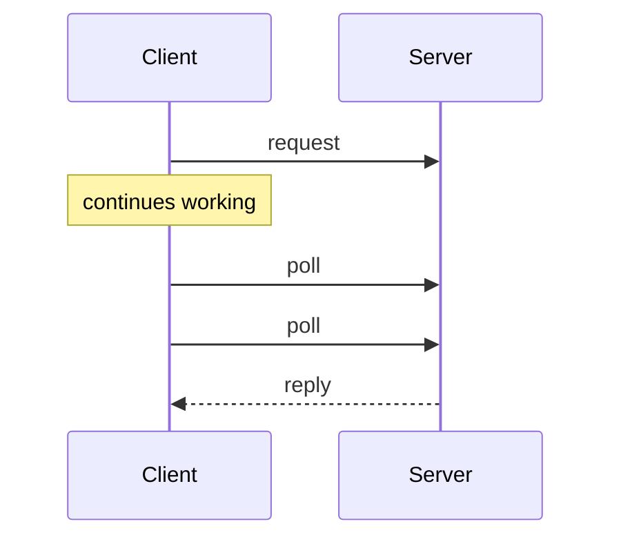
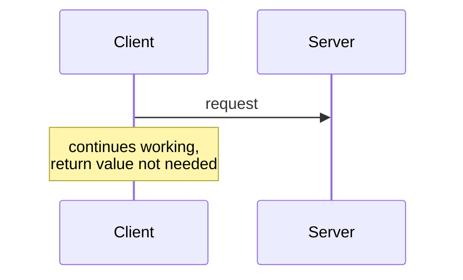

# Interaction Types

The four **transient** interaction types — what the client does while the server works.

## 1. Synchronous communication

The **client sends a request and waits for the reply.**



## 2. Asynchronous communication

The **client registers a callback and continues working.** On completion the **server calls
the registered function (callback).**



## 3. Deferred synchronous communication

The **client continues working** and **periodically checks whether the reply has arrived.**



## 4. One-way communication

The **client sends the request and continues working**; **no return value is needed.**



## Summary

| Type | Client blocks? | Reply? | Who initiates delivery of the reply |
|---|---|---|---|
| Synchronous | yes | yes | server, client already waiting |
| Asynchronous | no | yes | **server (push)** |
| Deferred synchronous | no | yes | **client (pull)** |
| One-way | no | **no** | — |

```text
# the distinguishing test
if no reply is expected        -> one-way
else if client waits           -> synchronous
else if server calls back      -> asynchronous
else (client polls)            -> deferred synchronous
```

> [!inference]
> Asynchronous vs. deferred synchronous is precisely the
> [[concepts/pull-and-push-style|push vs. pull]] distinction applied to the *reply* leg of a
> request/response exchange. Asynchronous needs the server to be able to reach the client —
> the registration problem again.

## Related
- [[concepts/synchronous-communication]]
- [[concepts/asynchronous-communication]]
- [[concepts/blocking-function]]
- [[concepts/pull-and-push-style]]
- [[concepts/persistent-and-transient-communication]]
- [[concepts/server-and-client]]
- [[chapters/03-architectures-and-web-systems]]
