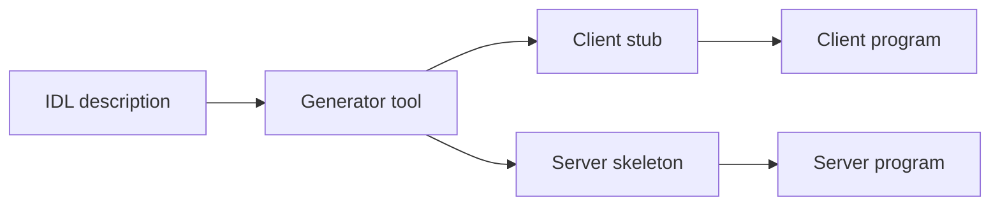

# Interface Definition Language (IDL)

> [!definition]
> An **interface description language** or **Interface Definition Language (IDL)** is a
> **declarative formal language** and **contains a language syntax for describing the
> interfaces of a software component.**

- With IDLs, **functions together with their parameters and data types can be described
  without using properties of a particular programming language.**
- **IDLs are extensions of external data representations** — see
  [[concepts/external-data-representation]].
- Their practical job: **generate the [[concepts/stubs-and-skeletons|stubs]].**

## Example: CORBA IDL

```idl
struct Person {
    string name;
    string place;
    long   year;
};

interface PersonList {
    readonly attribute string listname;
    void addPerson(in Person p);
    void getPerson(in string name, out Person p);
};
```

Note the **parameter direction markers** `in` and `out`: they exist because a remote call
cannot use pointers, so the IDL must state explicitly which parameters travel outbound,
which return, and which do both — see call-by-copy/restore in
[[concepts/stubs-and-skeletons]].

## How an IDL is used



**What information does such a tool need?**

- the **names of the functions**,
- the **types of parameters and return values**,
- the **address of the server**.

> [!inference]
> An IDL is "an extension of an external data representation" because the representation
> fixes *how a value of type T is encoded* while the IDL fixes *which Ts appear where*.
> Together they make a message unambiguous without either side shipping type tags — the
> compactness argument from [[concepts/external-data-representation]].

> [!exam]
> The IDL is **language-neutral by design**: that is what lets a C client call a Java
> server. It is the concrete mechanism behind the "uniform programming model" promised by
> [[concepts/middleware]].

## Related
- [[concepts/stubs-and-skeletons]]
- [[concepts/external-data-representation]]
- [[concepts/remote-invocation]]
- [[concepts/middleware]]
- [[exercises/ex04-rpc-rmi-and-ber]]
- [[chapters/04-remote-invocation]]
