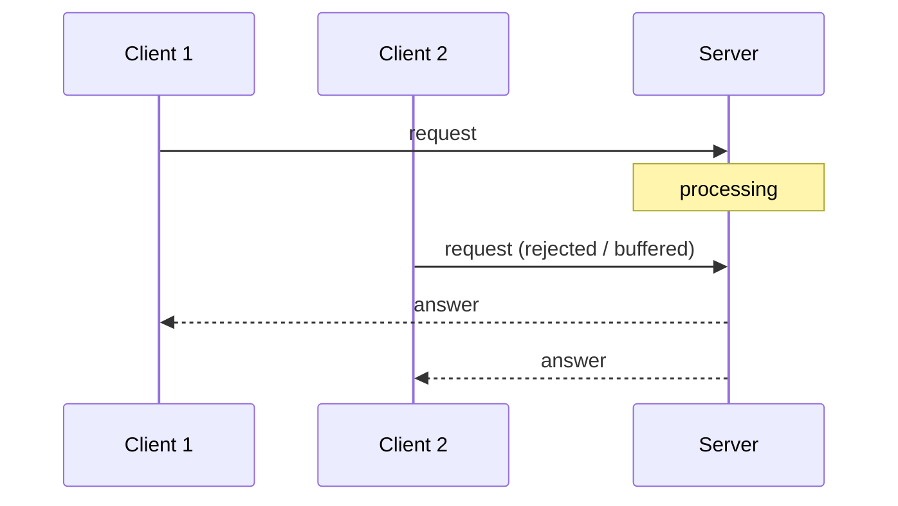
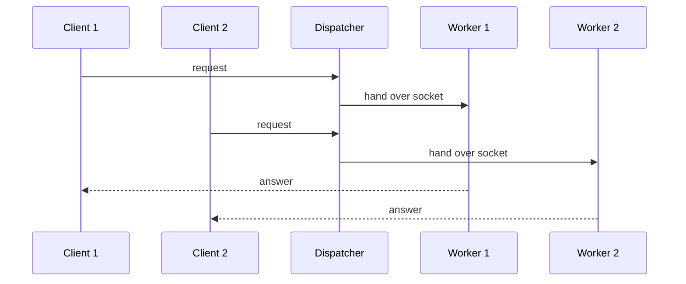

# Iterative and Concurrent Servers

How a single server process handles more than one request.

## Iterative server

- **Requests are processed sequentially** — a **single-threaded server**.
- Requests arriving **during processing are rejected, buffered or ignored**.
- **Only sensible for simple services with short processing times.**

```text
socket()
bind()
listen()
loop forever:
    conn ← accept()
    read(conn) / write(conn)      # the whole request, start to finish
    close(conn)
```



## Concurrent server

- **Several requests are processed simultaneously.**
- **Sensible for long requests.**
- **Realization: one thread or process per request.**
- Advantages: the **mean response time per request improves**, and there is **better
  utilization of the hardware**.

```text
socket()
bind()
listen()
loop forever:
    conn ← accept()
    fork()                        # or: start a new thread
    in the child:
        read(conn) / write(conn)
        close(conn)
```



### Concurrent TCP echo server (Java sketch, from the source)

```java
public class Dispatcher {
    ServerSocket sock = new ServerSocket(PORT);
    while (true) {
        Socket cSocket = sock.accept();
        WorkerThread at = new WorkerThread(cSocket);
        at.start();
    }
}
```

The dispatcher loop does nothing but `accept()` and hand the connection to a worker — it
must never block on application work, or the server degenerates to an iterative one.

## Comparison

| | Iterative | Concurrent |
|---|---|---|
| Threads | one | one per request |
| Suitable for | short, simple services | long requests |
| Behaviour under concurrent load | reject / buffer / ignore | serve in parallel |
| Mean response time | degrades quickly | improves |
| Hardware utilization | poor | good |

**Assumptions:** TCP sockets; the OS supports `fork()` or threads.
**Message complexity:** unchanged — one request/response pair per client.
**Time complexity:** iterative serializes, so the *k*-th waiting client sees a delay of
roughly *k* · processing time; concurrent sees ≈ one processing time while threads are
available.
**Failure behaviour:** in a concurrent server a crashing worker kills only its own request;
in an iterative server a hanging request blocks every other client.

## Related
- [[models/client-server-architecture]]
- [[concepts/sockets]]
- [[concepts/performance-criteria]]
- [[concepts/server-and-client]]
- [[concepts/tcp]]
- [[chapters/03-architectures-and-web-systems]]
