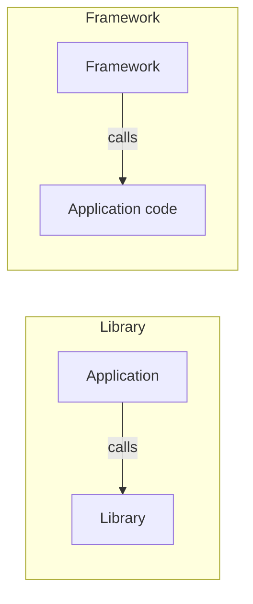
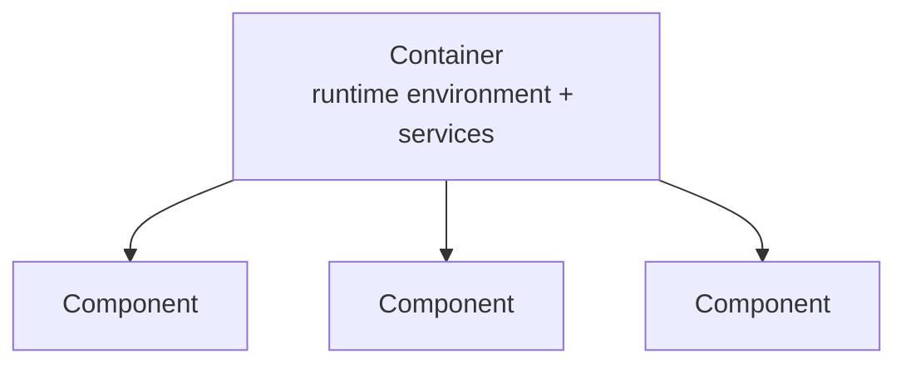

# Libraries, Frameworks and Containers

Three forms of reuse used to build application servers.

## Library

> [!definition]
> A **library** is a **collection of functions with solutions for thematically related
> problems.**

## Framework

> [!definition]
> A **framework** provides applications with a **reusable, common structure**. It **defines
> interfaces that are implemented by applications.**

## The Hollywood Principle

> [!theorem]
> **The application calls the functions of a library — but the framework calls the
> application.** ("Don't call us, we'll call you.")

With a framework the **application does not control the control flow**; control of the
control flow is **handed over to the framework**. This is **Inversion of Control (IoC)**.


*The direction of the arrow is the entire distinction.*

**Advantage:** the **framework implements an abstract design** — the structure is reused,
not just the functions.

### Services provided by frameworks

| Service | What it does |
|---|---|
| **Lifecycle management** | initialize, configure, start and destroy objects |
| **Naming service** | register, look up and deregister objects |
| **Configuration management** | implement objects via configuration files, through IoC |
| **Session management** | see [[concepts/sessions-and-statelessness]] |

## Containers

**Application servers are often implemented as containers.**

- The **container manages the components and hides the complexity.**
- **Components implement a predefined interface.**
- The **container need not know the components in advance.**
- **Containers offer a runtime environment and provide services.**



```text
# the container is a framework specialized to component lifecycles
on deploy(component):
    verify component implements the predefined interface
    initialize(component)
    configure(component)            # from configuration files, via IoC
    register(component)             # naming service

on request(r):
    c ← lookup(r.target)
    invoke c with the container's services available
```

> [!inference]
> A container is just a framework whose "application code" happens to be a pluggable
> component. The "need not know the components in advance" clause is what IoC buys you: the
> container calls an interface it defined, so it never has to name a concrete class.

Containers are the concrete realization of the services listed in
[[concepts/middleware]] — naming, transactions, persistence, events.

## Related
- [[concepts/middleware]]
- [[concepts/software-architecture]]
- [[concepts/fat-and-thin-clients]]
- [[concepts/sessions-and-statelessness]]
- [[exercises/ex03-architectures-and-http]]
- [[concepts/containers]]
- [[chapters/03-architectures-and-web-systems]]
