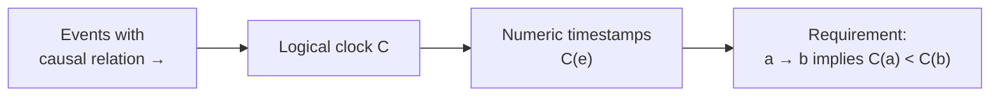

# Logical Clock

> [!definition]
> A **logical clock** (*logische Uhr*) **assigns timestamps to events in a distributed
> system, so that the causality of the events is recognizable: if an event `e₁` can
> influence an event `e₂`, then `e₁` must have a smaller timestamp than `e₂`.**

Written with the [[concepts/causality|happened-before relation]], the requirement is

```text
a → b   ⇒   C(a) < C(b)
```



> [!inference]
> Read the definition carefully: it is a **one-way implication**. The clock must never
> *contradict* causality, but nothing requires it to *detect* causality. Two events with
> `C(a) < C(b)` may be causally related or may be concurrent — the timestamps do not say.
> [[algorithms/lamport-timestamps|Lamport's algorithm]] satisfies exactly this and no more;
> [[algorithms/vector-clocks|vector clocks]] strengthen it to an equivalence.

> [!inference]
> A logical clock has **no relation to real time at all** — it is not an approximation of a
> physical clock, it is a different object that happens to share the word. That is what
> makes it immune to everything in [[concepts/clock-correctness]]: no drift, no skew, no
> resynchronization, and no need for [[algorithms/berkeley-algorithm|a time server]]. The
> course spends four pages failing to synchronize physical clocks exactly, then gets order
> exactly, for free, by giving up on real time.

> [!exam]
> State the requirement as an implication in the correct direction. *"`e₁` can influence
> `e₂`"* is the definition's way of saying `e₁ → e₂`; the conclusion is about timestamps,
> never the other way round.

## Related
- [[concepts/causality]]
- [[algorithms/lamport-timestamps]]
- [[algorithms/vector-clocks]]
- [[concepts/clock-correctness]]
- [[chapters/05-distributed-resources-and-synchronization]]
