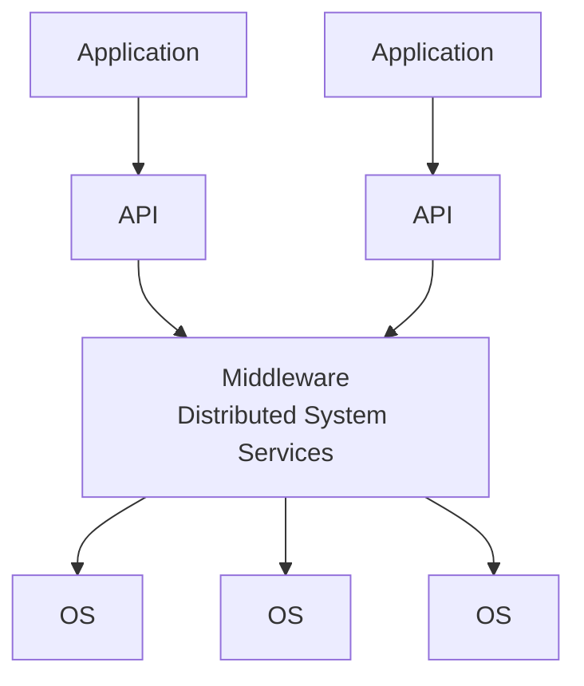

# Middleware

## Why it exists

Challenges in realizing a distributed system:

- **heterogeneous platform**
- **fault tolerance**
- **scalability** — see [[concepts/scalability]]

> [!inference]
> These challenges are **independent of a specific application** and therefore should
> **not be solved anew for every application**. That observation *is* the argument for
> middleware.

## Definition

> [!definition]
> **Middleware** is an **application-neutral software layer between the applications and the
> operating-system level, which hides the differences of the platforms.**

*The middleware spans machines; the applications see one uniform layer.*

## What it provides

**A uniform programming model:** the programming interfaces of all participating systems are
brought to one level, so that the **heterogeneity is hidden**.

**Building blocks for constructing components:**
- **remote method calls**
- **communication between processes**
- **notification about events**
- **replication of shared data** — see [[concepts/replication]]

These are **realized by processes or objects on several computers**.

**Services for applications:**

| Service | Purpose |
|---|---|
| **Naming service** | register, look up and deregister objects |
| **Transaction service** | atomic multi-step operations (cf. [[algorithms/two-phase-commit]]) |
| **Persistence service** | durable storage of objects |
| **Event service** | event distribution between components |

## The critical boundary

> [!warning]
> **Middleware provides NO application functionality.**
>
> It is marked emphatically in the source and is the standard trap: middleware supplies
> mechanisms (calls, events, replication) and generic services (naming, transactions), never
> business logic.

> [!inference]
> Middleware is the practical delivery vehicle for the
> [[concepts/transparency|transparencies]] from Chapter 2 — access and location transparency
> in particular are exactly "hiding the differences of the platforms".

## Related
- [[concepts/transparency]]
- [[concepts/scalability]]
- [[concepts/replication]]
- [[concepts/libraries-frameworks-and-containers]]
- [[concepts/software-architecture]]
- [[concepts/remote-invocation]]
- [[chapters/03-architectures-and-web-systems]]
