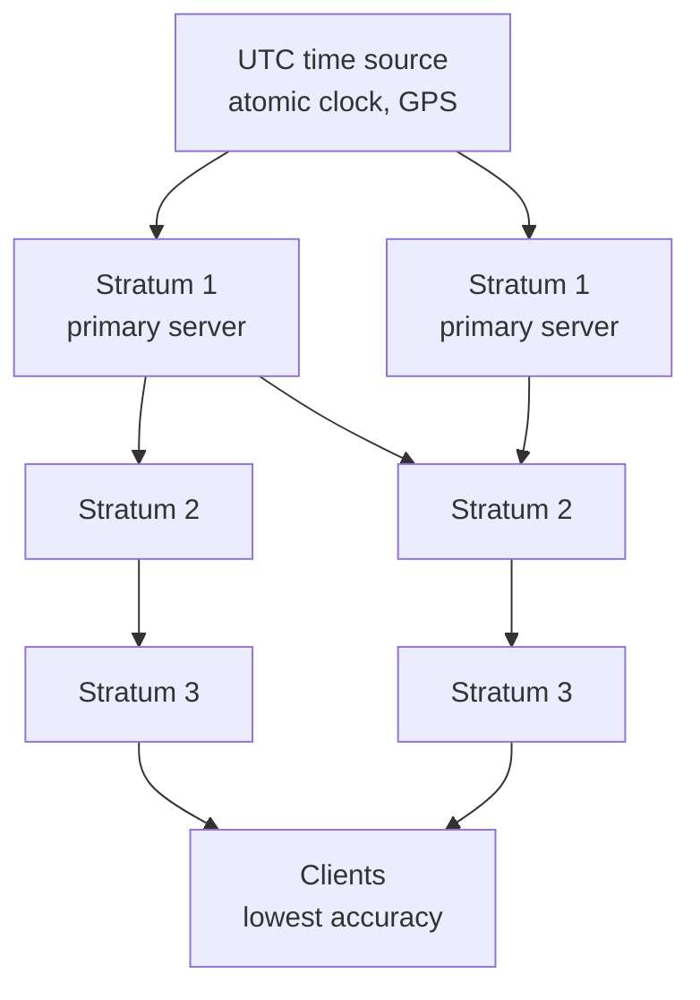

# NTP — Network Time Protocol

**External synchronization**, scaled to the internet.

## Goals

- **clients internet-wide should be synchronizable according to UTC**
- **the service should be scalable and reliable**
- **component or connection failures and transmission delays must be tolerated**

## Realization

- **a hierarchy of servers distributed over the internet**
- **primary servers are connected directly to a UTC time source**
- **secondary servers synchronize themselves with the primary ones, etc.**
- **the individual levels are called strata**
- **message exchange happens via UDP, port 123**
- **the accuracy decreases towards the leaves**

> [!inference]
> The hierarchy is how NTP buys **scalability** — the thing
> [[algorithms/cristians-algorithm|Cristian]] and
> [[algorithms/berkeley-algorithm|Berkeley]] were criticized for lacking. It is the same
> structural answer as the DNS-style hierarchy and the multi-server
> [[concepts/distribution-server|distribution]] arrangements of chapter 3: one bottleneck
> becomes a tree, and the tree's fan-out absorbs the load.

> [!inference]
> *"The accuracy decreases towards the leaves"* is the price. Each stratum adds a
> synchronization hop, and by the `2D` reasoning in
> [[concepts/clock-synchronization]] the errors accumulate down the tree. Scalability and
> accuracy trade off along the depth of the hierarchy — which is why a stratum number is
> quoted as a quality indicator.

> [!inference]
> The choice of **UDP** is deliberate rather than incidental. A timing protocol must not
> have its messages silently delayed by retransmission and in-order delivery — a late but
> reliably delivered timestamp is **worse than useless**, because it would be applied as if
> it were fresh. This is the clearest example in the course of the
> [[concepts/udp|"individual packets are not vital"]] criterion from chapter 1 being the
> *right* choice.

> [!exam]
> Three facts tend to be asked verbatim: the levels are called **strata**, primary servers
> sit **directly on a UTC source**, and the transport is **UDP port 123**.

## Related
- [[concepts/clock-synchronization]]
- [[algorithms/cristians-algorithm]]
- [[algorithms/berkeley-algorithm]]
- [[concepts/udp]]
- [[concepts/scalability]]
- [[chapters/05-distributed-resources-and-synchronization]]
