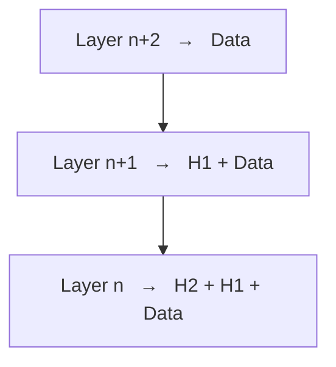
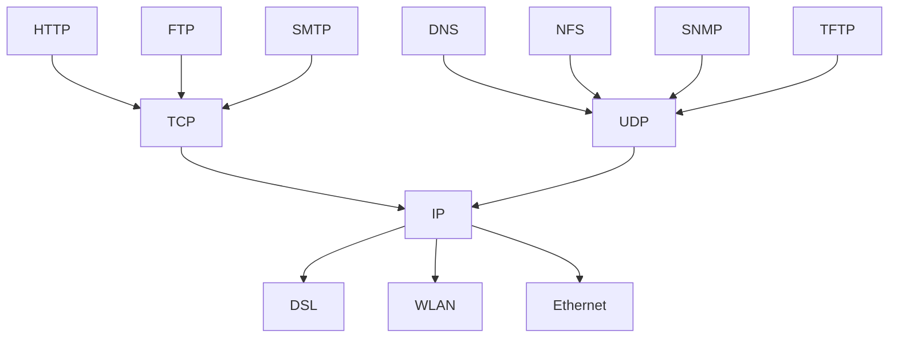

# OSI Model and the Internet Protocol Family

The OSI reference model splits network communication into seven layers (*Schichten*); each
layer adds its own header to the data it receives from the layer above and hands the result
down. Internet communication is realized by the internet protocol family, which maps onto a
condensed version of this stack.

## The seven layers

| # | English | German |
|---|---------|--------|
| 7 | Application layer | Anwendungsschicht |
| 6 | Presentation layer | Darstellungsschicht |
| 5 | Session layer | Sitzungsschicht |
| 4 | Transport layer | Transportschicht |
| 3 | Network layer | Vermittlungsschicht |
| 2 | Data link layer | Sicherungsschicht |
| 1 | Physical layer | Bitübertragungsschicht |

## Encapsulation

Each layer prepends its own header to the payload it receives:

*Every layer adds its own header; the layer below treats everything above as opaque payload.*

> [!definition]
> **Encapsulation**: a layer never interprets the headers of the layers above it. It sees one
> payload and adds one header.

## The internet protocol family

*The classic hourglass: many applications, two transport protocols, one network protocol,
many link technologies.*

> [!exam]
> Common trap: in the TCP/IP reference model **HTTP and TCP do not belong to the same layer** —
> TCP is transport, HTTP is application. Equally, the transport layer does **not** hide the
> unreliability of the session layer; the layer *below* transport (network layer) is the
> unreliable one. Both appear as false statements in
> [[exercises/ex01-tcp-udp-and-sockets]].

## Related
- [[concepts/ip-addressing-and-ports]]
- [[concepts/tcp]]
- [[concepts/udp]]
- [[chapters/01-networking-and-sockets]]
