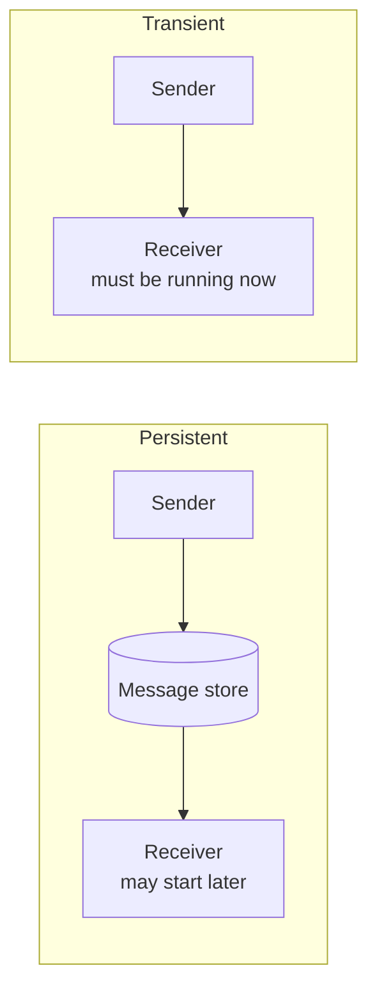

# Persistent and Transient Communication

How long does the **communication system** hold on to a message?

> [!definition]
> With **persistent communication** a sent message is **stored by the communication system
> until it can be delivered** to the receiver. The storage happens **at the sender or at an
> independent location**.

> [!definition]
> With **transient communication** a message is **only stored as long as the sending and the
> receiving application are running.**

| | Persistent | Transient |
|---|---|---|
| Receiver must run at send time | no | **yes** |
| Message storage | sender or independent broker | only in transit |
| Example | e-mail, message queues | TCP connection, HTTP request |

> [!inference]
> Persistence decouples the *lifetimes* of the two parties, while
> [[concepts/interaction-types|synchronicity]] decouples their *waiting*. The two axes are
> independent: you can have transient asynchronous communication (a callback over a live
> connection) and persistent synchronous communication (blocking on a queued request).

> [!exam]
> Do not confuse this with [[concepts/persistent-data-storage]]. There, "persistent" means
> data survives the program; here it means a *message* survives until deliverable. Same word,
> different subject.

## Related
- [[concepts/interaction-types]]
- [[concepts/communication-paradigms]]
- [[concepts/persistent-data-storage]]
- [[concepts/service-oriented-architecture]]
- [[chapters/03-architectures-and-web-systems]]
