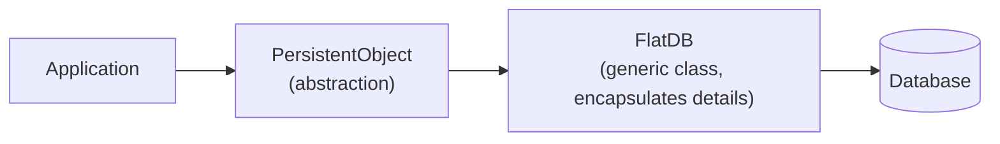

# Persistent Data Storage

Server state that must survive process restarts is kept in persistent storage
(*persistente Datenhaltung*), accessed through an abstraction rather than directly.

- Persistent storage is realized **by a database**.
- The abstraction offered to the application is a **`PersistentObject`**.
- The details are **encapsulated in a generic class `FlatDB`**.

*The application never touches the storage layer directly.*

> [!inference]
> The point of the `FlatDB` layer is substitutability: because the application only sees
> `PersistentObject`, the storage backend can change without touching application code. The
> summary does not elaborate the API further.

> [!warning]
> This page is thin — the source covers it in three lines. Expand it when the lecture slides
> for Chapter 1 are ingested.

## Related
- [[concepts/application-protocol]]
- [[models/client-server-architecture]]
- [[concepts/persistent-and-transient-communication]]
- [[concepts/sessions-and-statelessness]]
- [[concepts/file-system]]
- [[chapters/01-networking-and-sockets]]
