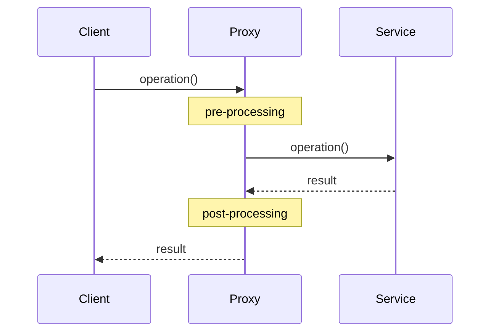
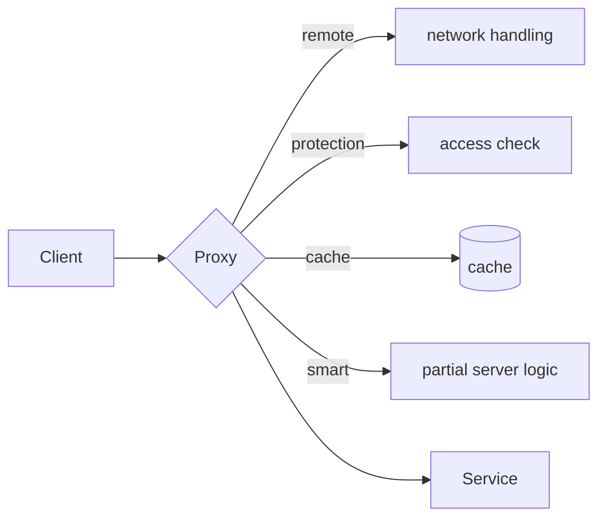

# Proxy

> [!definition]
> A **proxy** has the purpose of **controlling access to an object with the help of a
> representative object placed in front of it.**

A proxy is an **extension of the [[concepts/distribution-server|distribution server]]
concept**: it can do **more than just forward requests**. A proxy **offers the clients of a
component a representative for that component**.

## Advantages

- **Decoupling of the clients from the location of the server.**
- The **proxy relieves the client or the server of activities that are not immediately
  needed for carrying out the task.**

## Structure

The server provides operations; the **proxy implements the same interface** and **forwards
accesses to the server**.



```text
class Proxy implements ServiceInterface:
    state:
        service   # reference to the real component

    on operation(args):
        pre_processing(args)            # check rights, look in cache, marshal, …
        result ← service.operation(args)
        post_processing(result)         # fill cache, unmarshal, log, …
        return result
```

Because the proxy implements the *same interface*, the client cannot tell the difference —
this is what makes it a transparency mechanism; see [[concepts/transparency]].

## Types of proxy

| Type | What it takes over |
|---|---|
| **Remote proxy** | The client is **relieved of network addressing and inter-process communication**; the client just uses an API. |
| **Protection proxy** | Components are **protected from unauthorized access**; the proxy **checks access rights**. |
| **Cache proxy** | Clients **share the results of remote components**; the proxy has cache functionality. **Caches are intermediate stores located nearer to the clients than the actual objects.** |
| **Smart proxy** | The proxy **takes over parts of the server implementation**. |



> [!inference]
> The remote proxy is precisely how [[concepts/middleware|middleware]] delivers remote method
> calls: the generated stub *is* a remote proxy. The cache proxy is the mechanism behind the
> front-end caches of the [[concepts/http|web]].

## Related
- [[concepts/distribution-server]]
- [[concepts/transparency]]
- [[concepts/middleware]]
- [[concepts/http]]
- [[concepts/stubs-and-skeletons]]
- [[chapters/03-architectures-and-web-systems]]
