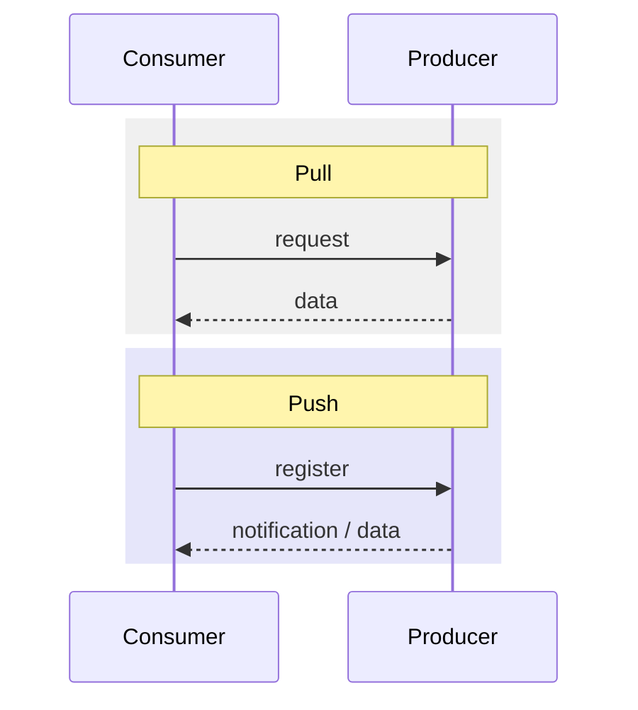

# Pull and Push Style

Who controls the information flow — the consumer or the producer?

> [!definition]
> In the **pull style** the **consumer controls the information flow**. A consumer
> **explicitly requests data from the producer**. Consumers are **not informed when the
> producer has new data**.

> [!definition]
> In the **push style** the **producer controls the information flow**. A producer
> **explicitly informs the consumer that new data is available**, or **sends data directly
> to the consumer unasked**.

- Pull ⇒ **client–server architecture**.
- Push ⇒ the **consumer must register with the producer**.


*The arrow that starts the exchange is the whole difference.*

## Choosing between them

```text
# network load, in messages per time unit
pull_load(poll_rate, n_consumers)  = poll_rate · n_consumers
push_load(change_rate, n_consumers) = change_rate · n_consumers
```

**Rule of thumb derived from the exercise:** compare how often the data *changes* with how
often it is *needed*.
- Data changes faster than it is needed ⇒ **pull** (do not send updates nobody reads).
- Data is needed more often than it changes ⇒ **push** (do not poll for unchanged data).

Worked quantitatively in [[exercises/ex03-architectures-and-http]] (task 3.2).

## Practical obstacle to push

Whereas the **address of the server is generally known to the client** — so pull
communication is easy — the reverse does not hold:

- **Clients must register with the server** so it knows where to push to.
- A **firewall or NAT can block push messages.**
- With a **very large number of clients**: many messages, and it becomes **hard to store all
  clients**.

> [!inference]
> This asymmetry is why the web is a pull medium by default and why push on the web needs
> extra machinery (long polling, server push in
> [[concepts/http-scalability|HTTP/2]], or a registration step).

## Related
- [[models/architectural-styles]]
- [[concepts/interaction-types]]
- [[exercises/ex03-architectures-and-http]]
- [[chapters/03-architectures-and-web-systems]]
