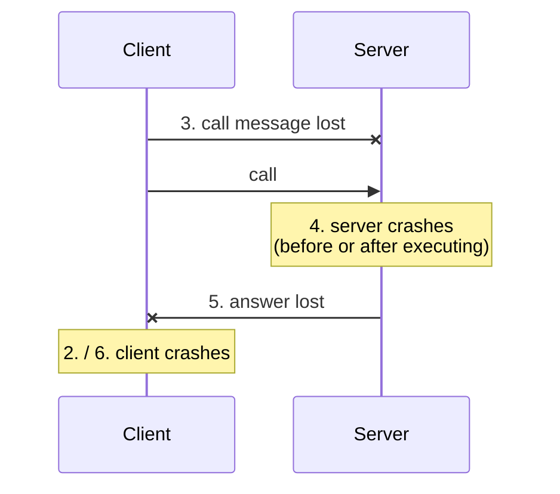
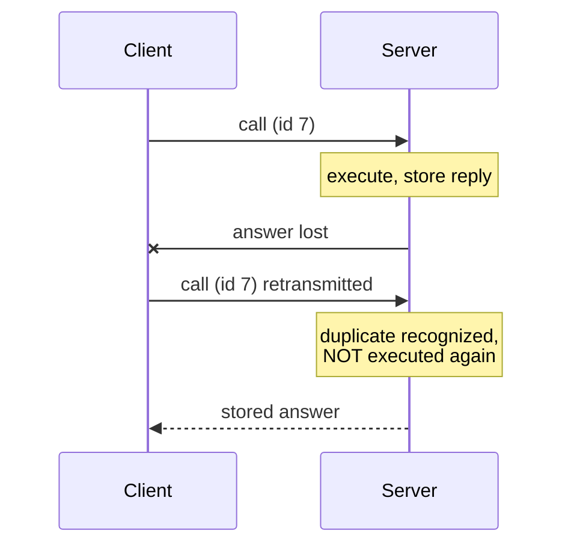

# Failure Situations in Remote Calls

The fourth and hardest difference from a local call: a local call cannot half-happen.

## The six failure situations

1. **The client does not find the server.**
2. **The client crashes after it has sent the call.**
3. **The call message is lost.**
4. **The server crashes after it has received the call,**
   - **but before it has sent the answer**, or
   - **but before it has executed the call.**
5. **The answer is lost.**
6. **The client crashes before it receives the answer.**



> [!exam]
> Note that case 4 splits in two, and that the split is **invisible from the outside**. The
> client sees the same silence whether the procedure ran or not. Every difficulty in
> [[concepts/call-semantics]] descends from this one fact.

## Lost call message

**Usual countermeasure: time-out and repetition.**

```text
attempts ← 0
repeat:
    send ⟨CALL, f, args⟩
    wait for reply, at most TIMEOUT
    attempts ← attempts + 1
until reply received or attempts = MAX_ATTEMPTS
```

**Problems:**
- **What is the maximum number of repetition attempts?**
- **How big is the timeout?**
- The call message may **not be lost at all — the server may merely be slow** (untypical
  behaviour) **⇒ a duplicate call message.** The **server should recognize duplicates.**

> [!inference]
> The timeout is unfalsifiable: no finite timeout can distinguish "lost" from "slow" in an
> asynchronous network. Retransmission is therefore not a fix but a *trade*, exchanging the
> risk of zero executions for the risk of two.

## Lost answer message

**1) Analogous to a lost call message.**
- **From the client's point of view the two are not distinguishable.**
- **It must be prevented that functions with side effects are unintentionally executed
  multiple times.**

**2) The server keeps a history of sent answers.**
- **If the server recognizes a call duplicate and has already executed the call → send the
  last answer again, without executing the function.**
- **Per client only the last answer must be stored.**



The full protocol is written out in [[algorithms/at-most-once-rpc]].

> [!inference]
> "Per client only the last answer must be stored" is what makes the scheme practical —
> the history is O(number of clients), not O(number of calls). It works only because the
> client is **synchronous**: it never issues call *n*+1 before receiving the answer to
> call *n*. See [[concepts/interaction-types]].

Operations that are **idempotent** need none of this; the distinction is what makes `GET` in
[[concepts/http]] safely retryable while `POST` is not.

## Related
- [[concepts/call-semantics]]
- [[algorithms/at-most-once-rpc]]
- [[concepts/remote-invocation]]
- [[concepts/stubs-and-skeletons]]
- [[concepts/interaction-types]]
- [[algorithms/two-phase-commit]]
- [[exercises/ex04-rpc-rmi-and-ber]]
- [[chapters/04-remote-invocation]]
